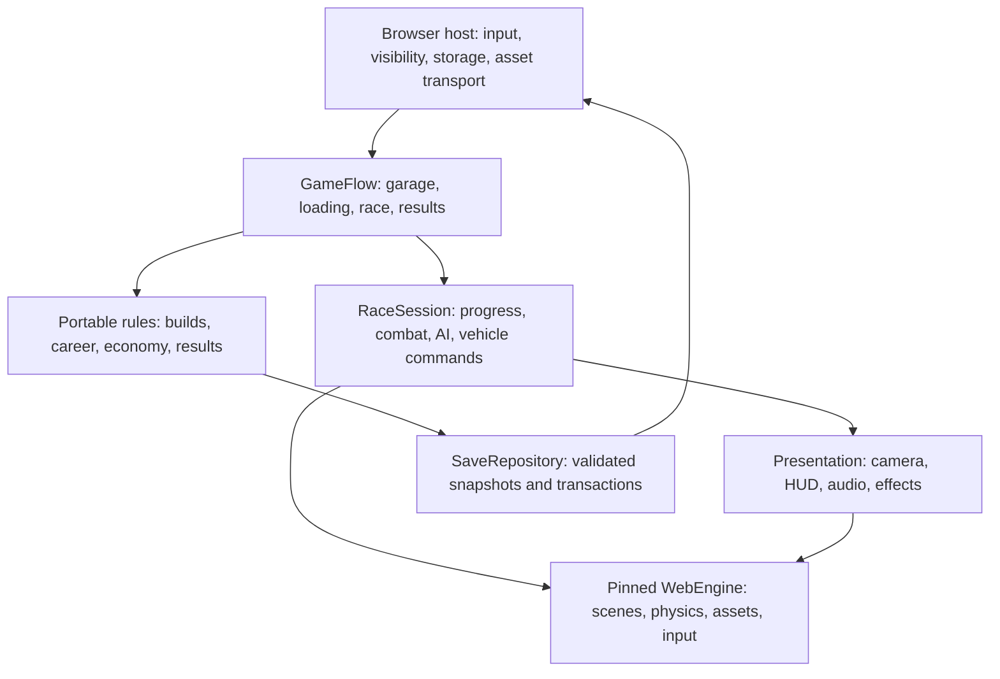

# RacingGame architecture

Status: proposed implementation architecture, 2026-10-20.

This document translates [the game design](game-design.md) into systems and
implementation stages for **Neon Ascension**. Visual requirements are defined in
[the visual design document](visual-design.md). The game design owns gameplay
intent and balance targets; this document owns technical responsibilities,
data flow, persistence and verification.

## Current foundation

The implemented [racing audio](racing-audio.md) uses a browser-host-owned portable
`RaceAudio` controller over the pinned `AudioSystem`. Scene snapshots supply RPM,
velocity and authoritative event counters; game code owns mixing, voice budgets
and pause policy. The engine owns source playback, shared buffers and HRTF.

The garage selects Kairox or the implemented [Desert Solar / Helios Run](desert-solar-track.md)
through a URL track identity. `Circuit` owns each route; the road mesh, physics
barriers, checkpoints, AI, recovery and minimap share it. `StarterScene` builds
only the selected environment, and the browser queues only its assets. Track
switching replaces the whole page/scene while retaining the saved career.
Desert placement, terrain and asset contracts stay in this consumer; WebEngine
continues to own importing, LOD, physics and rendering.

The implemented [city ground and service areas](city-ground.md) live in
`src/city_ground.hpp/.cpp`. `StarterScene` assembles immutable geometry after
city placement, while the existing validated Bastion import installs three
shared scenic service vehicles. Value-only placement/count/view records retain
no scene or callback lifetime. Sector batches, shared material sources and
static contact/light accents use existing renderer contracts; no collision,
save schema, engine API or dependency pin changes are introduced.

The city detail kit is implemented in `src/city_kit.cpp`, with generated resource
contracts in `src/city_kit_contract.hpp`. The game owns placement and clearance;
WebEngine owns GLB decoding, shared meshes/materials and rendering. Browser SHA256
checks precede import, and race readiness waits for the complete city kit. See
[the kit inventory and validation](city-detail-kit.md).
The [skyline expansion](skyline-expansion.md) replaces all 143 deterministic
skyline candidates with scaled shared city-kit instances and replaces the service
room box. No procedural tower/window-band fallback remains. Candidate selection and footprint clearance remain game policy in
`StarterScene::buildCity`; per-placement uniform scale leaves asset contracts and
shared LOD resources unchanged. The city kit now has 14 resources and 164 instances.

The repository now implements the first driving prototype: a wheeled car and
hovercraft, five AI rivals, a procedural Kairox circuit, a three-lap race with
live positions and finishing classification, boost, recovery, pause and restart.
See [the prototype implementation and validation](prototype.md)
for its current boundaries. Pulse cannons and shields are implemented as
[application-owned combat](combat-prototype.md). [Race winnings, per-vehicle
upgrades and local saves](progression.md) are also implemented. Further equipment,
league progression is now implemented as described in [championship career](championship.md).
The broader production career architecture remains proposed below.

`Championship` in `src/championship.hpp` owns the five-level ladder, alternating
track schedule, stable-racer round history, points, ties, final qualification and
title bits plus five persistent latest/best season pairs. `LeagueSeason` snapshots
contain value-only standings and final results. `Progression` serializes the whole
career with wallet and paint in one bounded NA5 snapshot, reading NA1–NA4 profiles. `StarterScene` captures an event revision, temporarily
caps player upgrades and equips rivals, and commits a complete final result with
the race payout once. Save state outlives the browser track scene; reload resumes
at the next uncompleted round, not mid-race. The browser career dialog publishes
derived standings and saved player records. Direct garage continuation carries
a one-use revision token across scheduled page travel, then starts only the
matching saved event. Invalid/stale tokens return to career review. The engine and selected dependency boundary are unchanged.

Vehicle shield presentation is implemented in `src/shield_effect.hpp/.cpp`.
Each vehicle owns a retained component with shared immutable geometry and a
fixed three-impact pool. Game fixed ticks drive its animation from authoritative
combat state; camera presentation only orients the silhouette. Art installation
fits the shell and recovery/reset clears transient effects. The existing engine
owns additive depth testing and rendering on both backends. See
[shield implementation and validation](shield-effect.md).

Static environment art is prepared once before scene publication by
`src/static_art.hpp`. The game calls the pinned engine's `MeshOptimizer` for
lossless vertex/index optimization and three shared static LODs. All instances
share these immutable levels and the original materials; the engine owns
projected-size selection and hysteresis. Contract validation and collision use
the full-detail geometry. Puddle accents request environment shading without a
planar city capture. See [performance evidence](performance-diagnosis.md).

The inspected WebEngine submodule is
`619ce5e7b5fc2965754b4fd4ce0c4cf96494f018`, which adds the WebGL2
[material shader performance fix](webgl2-performance-fix.md) and retains the vehicle rotation
stability fix to the original `0426d93` baseline. Relevant existing contracts include:

| Capability | Selected engine contract | Game integration required |
| --- | --- | --- |
| Scene ownership, clocks, pause and transitions | `Application`, `Scene`, actor/component handles | Game flow and race session lifetime |
| Wheeled simulation | `VehicleComponent`, immutable `VehicleDefinition`, `RigidBodyComponent` | Arcade tuning, drift/boost policy and damage |
| Spatial queries and collision | `PhysicsWorld`, physical surfaces, compound shapes | Hover support, weapon queries, checkpoint validation |
| Road geometry | `SplineAsset`, `RouteAsset`, `RouteComponent` | Track graph, route legality, AI racing lines and progress |
| Input and chase camera | Input bindings, browser gamepad adapter, `CameraFollowRig` | Game action mapping, assists and camera settings |
| Presentation | Renderer facade, retained GUI, audio, assets and effects | HUD, garage, sound mapping and loading flow |
| Scene serialization | Scene archives and supported component codecs | Career schema, transactions and browser storage |

See the selected engine's [architecture](../external/WebEngine/architecture.md)
and [headers](../external/WebEngine/include/engine). Verify the pin again before
implementation; development skills may describe newer APIs.

The current browser entry point is [browser_main.cpp](../src/browser_main.cpp).
[CMakeLists.txt](../CMakeLists.txt) builds `racing_scene`, `racing_smoke` and the
browser `racing_site`. The consumer's [CMake adapter](../cmake/WebEngine.cmake)
packages upstream renderer sources as `racing_engine_browser`. Existing browser
input, GUI, asset and audio adapters still need explicit linkage, staging and
initialization as the game starts using them.

## Runtime boundaries

Use one portable C++ game runtime compiled for native tests and browser Wasm.
The browser host supplies devices, storage, asset transport and presentation.
Initial release requires no game server or account service. Local time-trial
records are supported; public leaderboards and multiplayer require a separate
future design for authoritative validation.



Keep race rules, equipment, tuning, tracks, economy and UI in RacingGame.
Reusable engine mechanisms belong in WebEngine and must be published before
updating the game pin. Do not copy the Formula demo or depend on the adjacent
development checkout.

Game modules communicate through typed commands, snapshots and bounded events.
The UI submits intentions such as `PurchasePart` or `EnterEvent`; the owning
system validates them and returns a result with a reason. UI code never writes
credits, equipment legality, lap counts or damage directly.

## Proposed source organization

Create these modules incrementally when their milestone needs them. These paths
are a target structure, not existing files.

```text
src/
  app/           GameFlow, scene factories, dependency composition
  content/       Definitions, stable IDs, catalog validation
  vehicle/       Build compiler, car controller, hover controller
  race/          Session, track progress, modes, results, recovery
  combat/        Equipment activation, targeting, projectiles, damage
  ai/            Racing lines, overtaking, tactical decisions
  career/        Ownership, purchases, championships, sponsorship
  persistence/   Save schema, migrations, transaction policy
  presentation/  HUD, garage, camera, vehicle visuals, audio and FX
  platform/      Browser adapters and native test substitutes
assets/runtime/  Reviewed meshes, textures, audio and content packages
tests/           Portable rule tests and scene integration tests
```

Keep rules that do not need scene objects in a small portable library. Scene
integration depends on that library and `engine_core`; browser adapters depend
on the integration layer. Add optional engine libraries only when consumed.
Native tests do not need a renderer, browser, provider key or paid service.

## Ownership and identities

`GameFlow` owns the active career and requests scene transitions through
`Application`. `Application` owns scenes; each race scene owns one `RaceSession`
and its actors. A session contains the immutable event configuration, resolved
vehicle builds, participant roster, race clock, progress and combat state.

Use three distinct identity types:

- Content IDs identify definitions across builds, such as a chassis or track.
- Save IDs identify owned vehicle/part instances, profiles and race attempts.
- Engine actor/component handles identify live objects in a particular scene.

Never serialize runtime pointers or engine handles into the career. Delayed
callbacks resolve handles and check a session generation before publishing.
Scene deactivation cancels input, asset interests, audio and subscriptions;
renderer and camera borrows are released before scene destruction.

Published mesh, material, route and vehicle definitions are shared and immutable.
Per-racer hull, battery, heat, cooldowns, commands and visual damage are independent.
The physics body owns the moving chassis pose; visual children and the chase
camera consume it without writing back into simulation.

## Flow and fixed simulation

The outer flow is:

```text
Boot → Load profile → Garage → Event preparation → Loading → Countdown
     → Racing → Finish resolution → Save result → Results → Garage
```

Practice uses a separate temporary session with no economy rewards. A restart
creates a new race attempt; returning to the garage abandons an unfinished
attempt without awarding its race stipend. Explicit pause freezes simulation.
Tab hiding suspends the application and clears held input. Return to the tab
requires safe input re-arming and preserves an explicit pause.

Use `Application` as the only clock/scheduler owner, initially at a 60 Hz fixed
step. Race elapsed time, hazards, damage, cooldowns, EMP immunity and recovery use
completed simulation steps. Wall-clock time and presentation frames cannot grant
race progress or resources.

The selected engine runs variable updates before its fixed-step batch and
offers `afterSimulation` after that batch. Actor/component fixed ticks run
before the physics solver. It does not expose a general application callback
after every individual solver step. Integrate deliberately:

1. Browser input maps into held axes and queued action edges. Consume each edge
   once, even when a frame contains zero or several fixed steps.
2. A session coordinator's fixed tick consumes any unprocessed previous solver
   output, resolves game events, advances timers and plans the next commands.
3. Controllers submit car commands or hover forces. WebEngine steps physics
   exactly once through its normal `Scene::fixedUpdate`.
4. Collision callbacks collect observations without mutating scene structure.
5. Before another fixed step, consume its predecessor's output. In
   `afterSimulation`, consume the final outstanding step and publish snapshots.
   A step sequence number prevents duplicate consumption.
6. Update the camera from interpolated presentation poses, then HUD/audio/FX,
   and render. These operations cannot change race outcomes.

Implement and test the coordinator's traversal order explicitly; sibling
component ordering is not a global ordering guarantee between actors. If this
integration needs a cleaner reusable post-physics hook, add and publish it in
WebEngine before changing the game pin. Do not add a second fixed-step loop.

## Content and vehicle builds

Use typed definitions with explicit schema and catalog versions. Start with
compiled C++ fixture data for the driving prototype; add validated external
content when iteration needs it. No JSON loader is assumed to exist in the game.

| Definition | Essential data |
| --- | --- |
| Chassis | Class, mass, collider, hardpoints, capacity and compatible parts |
| Part/equipment | Tier, compatibility, power/mass cost, tuning, price, action type |
| Track | Geometry references, route graph, gates, safe anchors, surfaces, hazards |
| Event | Mode, track/layout, laps, roster, tier/power restrictions, reward table |
| League | Four-race schedule, final, points, qualification and promotion |
| Rival | Legal build, behavior preferences, difficulty parameters, dialogue IDs |
| Presentation | Asset IDs, material variants, audio/FX mappings and palette tokens |

Validate unique IDs, references, finite numeric ranges, bounded counts, graph
reachability and starter availability before publishing a catalog. An invalid
replacement retains the previous valid catalog and reports its offending field.

`BuildCompiler` resolves an owned loadout into an immutable `ResolvedBuild`.
It checks ownership, compatible slots, tier restrictions and total fitted power.
The same result drives event entry, AI builds, statistics, practice and physics.
Return structured violations pointing to a part or capacity, with a reversible
legal preset. Preserve three named loadouts per vehicle.

Cars compose the engine's four-wheel vehicle foundation with game-owned grip,
drift, boost and surface tuning. Hovercraft use a dynamic rigid body, bounded
ground probes, damped support forces, lateral drag, air braking and stabilization.
Support follows permitted track surfaces and authored jump corridors; a loss of
support does not create free flight or a snap to a road on another level.

Both controllers consume the same `DriveCommand` semantics: throttle, brake,
steer, slide and boost. Use meters, kilograms, seconds, +Y up and +Z forward.
Caps, acceleration and assists derive from the resolved build. Test collision
stability and class balance on the same track before adding chassis.

Battery regeneration and drafting are time-based and require valid forward
racing, sufficient speed and a qualifying opponent ahead. Stationary sliding,
repeated gate crossings and recovery cannot generate extra battery.

## Track graph, progress and recovery

Separate road geometry from race topology. Engine splines generate or sample
road surfaces; RacingGame defines directed segments, legal branch connections,
ordered checkpoint gates, racing lines and recovery anchors.

Each gate has a forward direction and bounded crossing area. Validate crossings
against the swept movement between consecutive solved poses, the expected gate
and legal segment transitions. Process multiple crossings in travel order.
Reject reverse crossings, off-corridor shortcuts and teleport movement.
Overpasses require segment continuity and vertical bounds; nearest world-space
spline distance alone cannot select a valid road.

Ranking compares completed laps, ordered checkpoint progress, then normalized
progress within the current legal interval. Alternate branches between two gates
map to the same interval so a longer branch does not inflate ranking. Finish
order is frozen from valid finish crossings; same-step crossings use their
interpolated crossing fraction, followed by a stable participant-ID tie break.

Recovery uses the latest valid safe anchor at or behind accepted progress.
Check clearance before placement and use a nearby eligible anchor if occupied.
Reset velocity, camera history and previous-pose sweep history. Retain checkpoint
state without granting a new crossing. Off-track recovery incurs its configured
time cost; zero-hull recovery waits approximately three seconds and restores
60 hull with two seconds of visible protection.

Protection disables firing and vehicle blocking while preserving road support.
Select collision/query filters accordingly. Recovery never refills ammunition,
charges or battery. These invariants also apply to AI.

## Race modes and combat

An immutable `RaceRules` policy defines lap/finish conditions, equipment
permissions, recovery and elimination behavior. Circuit starts with eight racers
and three laps; sprint has a terminal route; time trial has one racer and no
weapons. Clean circuit disables offensive systems. Elimination adds announced
intervals and a grace period in a later milestone.

Weapons unlock three simulation seconds after the start. `CombatSystem` checks
mode, racer state, cooldown, ammo, heat, battery and targeting before accepting
an activation. Rejecting an action returns its HUD reason and consumes nothing.
Accepted activations reserve resources once and emit an action ID.

Forward, rear/utility and defense slots stay distinct. Pulse fire uses bounded
hit queries or swept projectiles; missiles use guided projectiles with validated
target handles; mines use armed proximity volumes and finite lifetimes.
Combat objects have fixed capacity and explicit admission rules so overload
cannot create free damage or spend resources on an unspawned projectile.

Lock-on requires a valid forward target and continuous line of sight for the
configured one-second acquisition. Cover and disruptor clouds invalidate
acquisition. Missile retarget/decoy behavior uses explicit rules, without
unlimited reacquisition. Damage comes from simulation queries, never particles
or visual collision.

Apply damage through one resolver: protection, shield/EMP rejection, hull,
healing interruption, bounded impulse and disabled state. EMP blocks boost and
energy weapons for 1.25 seconds, preserves steering/brakes, cannot stack and is
followed by three seconds of immunity. Overheat uses a separate recovery
threshold to prevent button-spam bypass. Ammo and module charges last the race.

Defaults such as shield capacity, defense costs and weapon ammunition live in
content definitions matching the game design. Collisions use relative closing
speed and a contact cooldown to prevent repeated resting-contact damage.
Damage and takedowns award no independent credits.

## Opponent AI

AI emits the same commands as the player and uses the same vehicle, build,
combat and recovery systems. Racing lines are authored against the track graph;
look-ahead steering and speed targets account for curvature, braking distance,
surface and nearby racers. General pedestrian navigation is not required.

Separate continuous driving control from lower-frequency tactical decisions:
route choice, passing side, drafting, defense timing and weapon selection.
Give decisions bounded work budgets and seeded variation for reproducible
fixtures. Difficulty changes reaction delay, planning, aim error and risk.
It never secretly changes speed, grip, ammunition or damage because of the
player's position.

## Career, economy and persistence

Career state owns credits, non-spendable reputation, vehicles, part instances,
loadouts, unlocks, sponsor progress and championship records. Store currency as
checked integers. A purchase or sale validates a candidate state and publishes
it only with a successful save transaction. Record actual part purchase price
so resale can apply the design's 70 percent policy with defined integer rounding.

The implemented six-racer career uses 15/12/10/8/6/4 points. Street, District,
Metro and Elite each run four rounds; the top three qualify for a separate,
retryable promotion final. Master Championship is decided by six points rounds.
Ties compare wins, then other finishing-position counts, then the latest result.
Failed seasons retain money, equipment and unlocked titles. The current schedule
alternates Kairox and Desert Solar, with complete saved round history outside
track scenes. Full-career balance and additional city content remain future work.
Any shortened validation fixture must be labelled explicitly.

Proposed production storage beyond the current NA3/localStorage profile is a `SaveRepository` interface with an IndexedDB browser
adapter and a native in-memory/file test adapter. Keep save encoding and
migrations portable. A save envelope includes schema version, catalog version,
profile ID, revision, payload and integrity information. Integrity checks detect
damage; local saves are not a secure anti-cheat authority.

Race rewards must be idempotent:

1. Persist a unique attempt ID and event/build versions before race entry.
2. Produce one immutable result for that attempt after finish resolution.
3. In one storage transaction, check the attempt receipt, apply credits,
   objectives, standings and unlocks, mark the receipt applied, and advance
   the profile revision.
4. A duplicate result returns the existing receipt without another reward.
   A different result claiming the same attempt ID is rejected.
5. Publish the saved career and enable spending after commit acknowledgement.
   On failure retain the pending result and offer retry/export recovery.

Use the same transaction discipline for purchases and loadout changes. Compare
expected profile revisions inside the transaction to reject stale writes from
another tab. Serialize profile commands so two purchases cannot overspend.
Persist a pending result before presenting it as safely recorded; an abrupt
browser termination before durable storage can still lose an unsaved finish.
Do not claim loss-free saving at arbitrary termination points.

Retain a previous known-good snapshot, validate before replacement, and migrate
on a copy. Unknown future versions open an explanatory recovery flow rather
than resetting the career. Support explicit export/import with bounded parsing.
Initial scope resumes between races; it does not promise exact mid-race solver
restoration. Scene archives are useful for authored content, not a substitute
for career transactions.

## Presentation, loading and performance

Use engine GUI and browser accessibility adapters for game screens, with a thin
DOM shell for startup and platform failures. HUD and garage read stable view
models and submit commands. Keep event entry and purchase actions visible while
lists scroll; legality messages select the relevant slot. Controller focus,
keyboard navigation, remapping and scalable text are part of acceptance.

One chase-camera rig writes the camera after simulation. Pause, recovery and
scene changes reset relevant temporal state. Warning shapes, countdowns,
subtitles and sound cues communicate threats without relying only on hue.
Audio is activated through a browser user gesture; mute/suspension state is
handled independently of game rules.

Load one event's scene and dependencies at a time. Validate and prepare the next
scene before transition, retaining the garage on failure. CPU asset readiness
does not establish GPU upload completion; profile loading and first visible
frames separately. Release race-only resources on return.

Target 60 fps on agreed desktop reference hardware, with 16.7 ms as the total
frame budget. This is a goal, not measured acceptance. Bound projectiles, AI
queries, effects, lights and loading work; report overflows and dropped
simulation time. Quality settings reduce resolution, shadows and decorative
effects while preserving collision, warnings and track readability.

Both renderers use identical gameplay. Query capabilities for presentation
choices; WebGL2 may need simpler lighting. Service renderer recovery while
unready and suspend competitive simulation when the player cannot see the race.
Do not make the scene readable only through expensive reflection or bloom.

## Delivery and evidence

| Stage | Deliverable | Required evidence |
| --- | --- | --- |
| Driving prototype | One greybox loop, car, hovercraft, chase camera, valid laps and recovery | Native progress/recovery checks; keyboard/controller driving on both renderers; human handling feedback |
| Combat prototype | Eight racers, pulse/seeker/mine, barrier/decoy and results | Shared AI rules, cover/lock tests, no stun chains, recovery resource invariants and bounded workloads |
| Career slice | Finished Kairox track, two starters, three events, rival final and upgrades | Reward/purchase/reload loop, duplicate receipts, failure injection and save migration |
| Initial release | Three Kairox layouts, four chassis, two leagues, circuit/time trial and ending | Complete career playthrough, class/economy balance, accessibility and agreed hardware performance |
| Expansion | Five cities, ten chassis, five leagues and further equipment/modes | Content compatibility, new-route balance and regression of existing careers |

Portable tests should cover build legality, checkpoint ordering and branch
ranking, finish ties, resources, timers, championship qualification and atomic
save/reward behavior. Scene tests cover physics integration and lifecycle.
Browser checks cover devices, pause/tab hiding, storage failures, repeated
scene transitions, audio activation and renderer recovery.

Use [the development commands](development.md) and inspect the generated
`build/web/site/build-info.json`. Verify that exact site with
`?renderer=webgpu` and `?renderer=webgl2`, checking the actual selected backend.
Native success does not prove browser performance or controller usability.
Documentation changes require content/link checks, not a game rebuild.

Outstanding tuning decisions include hover support constants, contact damage,
time-trial assist categories, DNF/finish timeout policy, and concrete hardware,
memory and asset budgets. Resolve these at the milestone that needs them and
record the chosen values with evidence. Multiplayer, free flight, an open world,
procedural tracks and destructive cities remain outside initial scope.

## Implemented racing corridor art

`trackkit::Kit` in `src/track_kit.cpp` owns the game's Tripo barrier, gantry,
lamp, sign and sidewalk placements. It shares immutable imported meshes,
stages successful installs atomically, and selects six nearby point lights
within the engine's existing light budget. `StarterScene` retains the original
continuous barrier physics. Runtime contracts and the browser asset queue gate
race readiness on the complete kit. See [track kit integration and validation](track-kit-integration.md).
