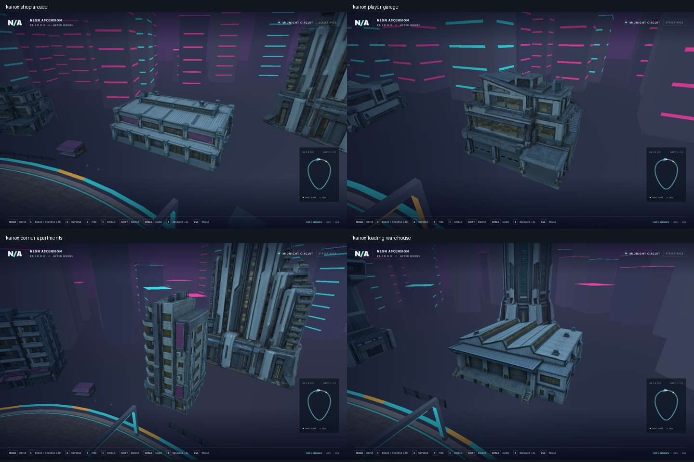

# Trackside building integration

The Midnight Circuit now contains three market apartment blocks, three service
depots, two transit control towers and one each of the market arcade, player
garage, corner apartments and loading warehouse, using seven Tripo GLBs.
They replace nearby placeholder skyline boxes while preserving the distant city.
The imported buildings face the track; two apartment blocks sit on the inner
side and the other ten buildings sit outside the circuit.

The four new landmarks replace repeated original buildings, retaining twelve
major trackside placements: player garage at sample 0 beside the starting grid,
arcade at sample 12 on the market bend, warehouse at sample 80 on the service
stretch, and corner apartments at sample 112 on the return. Their source art is
documented in [generated building expansion](generated-building-expansion.md).

## Scene and loading

`StarterScene::planBuildings` places buildings relative to the authoritative
road samples. A conservative footprint radius maintains at least 16 m from the
track centre, leaving space beyond the 12 m road-and-shoulder envelope. The
placement samples avoid the elevated transit corridor. Skyline boxes whose
footprints could overlap a building are omitted during the static skyline bake.
Placement also checks the full bounding circles against earlier buildings and
uses a bounded outward search for clearance. City-detail placement accounts for
these larger footprints before selecting its own locations.

`installBuildingArt` validates part/material counts, triangle counts, metre
dimensions and ground origin before publishing the staged actors. Each type
shares one immutable mesh and its textures across every instance. Each building
has one static box collider covering its footprint and height. Existing race
barriers remain the normal contact boundary. No new provider calls were needed.

The browser downloads each GLB once through the sequential scene asset queue.
SHA-256 values are pinned in `src/building_art_contract.hpp`. Race entry is
guarded in C++ until every vehicle and building is installed. A failed building
download retains the successful assets and offers **Retry city download**;
retry resumes the remaining queue without duplicating existing actors.

The models retain their full-detail source geometry and use 1K color/normal/ORM maps.
Before actors publish their shared meshes, `static_art.hpp` applies lossless
cache optimization and generates three error-bounded distance LODs. Materials
and maps are shared across all levels; close views keep the original surfaces.
They add 487,201 instanced triangles across the full circuit (before view
culling), with seven distinct mesh/texture resources. There are no new
engine changes, baked LODs or dynamic building lights.

## Four-building expansion verification — 2026-10-21

Selected engine remained `9b597da84d4582973d010fa9ba3e328c20181892`, clean,
with Emscripten 6.0.11. The tested browser build is frozen under
`build/building-expansion/site`; its `racing.wasm` SHA-256 is
`3e56b0850721e83cbaef299ce8756ae6230a4132ad409aced88f7afe6329c802`.
Source hashes are retained in `build/building-expansion/source-hashes.json`.

- The native smoke and chassis-race suites passed after adding the four models.
  Building tests cover all seven imports, shared resources, solid collision,
  nonoverlapping footprints, road clearance, failed-import preservation and
  readiness when the final new building is missing despite other art being ready.
- `scripts/building-art-smoke.cjs` passed serially on WebGPU and WebGL2 in
  Chrome 155. Both runs rejected a corrupted warehouse download while keeping
  the six successful building imports, blocked race entry, then resumed the
  queue on Retry city download. All seven asset hashes and the twelve-instance
  distribution were verified.
- Both backends completed a physical hover lap with zero recoveries, paused
  without advancing race time, and returned to the garage without duplicate
  building placements. Browser/GPU error lists were empty.
- Four landmark close-ups per backend were visually inspected, along with
  driving views. An explicit `?buildingReview=3` through `6` authoring camera
  exposes those landmarks for review; ordinary race cameras remain unchanged.

Evidence is in `build/evidence/building-expansion/results.json` and adjacent
screenshots. The frozen build includes the street and city-detail kits present
at capture time. Later concurrent track-kit changes are outside that browser
evidence; an attempted latest-checkout native rerun encountered a track-kit
asset-contract mismatch. This is desktop browser evidence, not physical mobile
or dense-city performance acceptance. Integration incurred no provider charges.

## Original three-model verification — 2026-10-21

Selected engine: `9b597da84d4582973d010fa9ba3e328c20181892`, clean submodule;
Emscripten 6.0.11. Generated `racing.wasm` SHA-256:
`1b5be7dca76a1f957446569794fab2b185a040d43ee26aa66e1d2cbebe1cb57e`.

- `python scripts/dev.py native --jobs 4`: both CTest suites pass. All native
  gameplay fixtures now install the buildings, so complete races exercise the
  new colliders. Building checks cover failed-import preservation, counts,
  shared resources, road clearance and nonoverlapping footprints.
- `scripts/building-art-smoke.cjs`: serial Chromium checks on WebGPU and WebGL2
  verify exact asset hashes, partial-load preservation, retry, C++ race-entry
  guard, all twelve placements, a complete physics-driven hover lap without
  recovery, pause and return to garage. Six track positions per renderer are
  captured and visually reviewed; no browser/GPU errors are accepted.

Evidence lives in `build/evidence/building-art/results.json` and the adjacent
screenshots; native results are in `build/native/Testing/Temporary/LastTest.log`.
This establishes desktop browser rendering and gameplay, not a physical mobile
or dense-city performance budget. Original generation records remain in
[generated buildings](generated-buildings.md).
