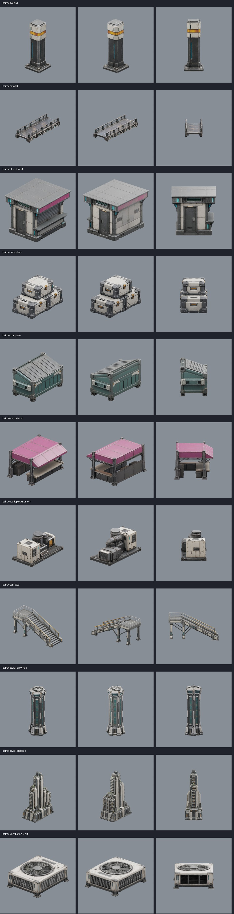
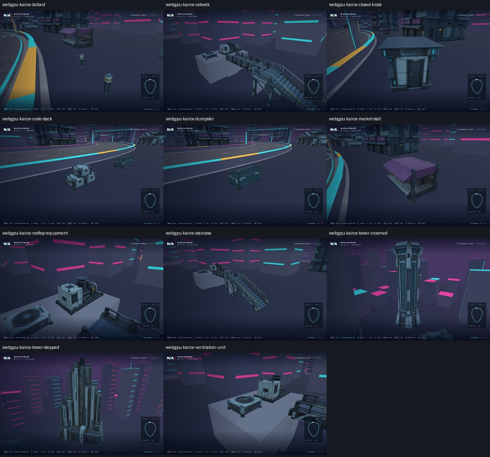
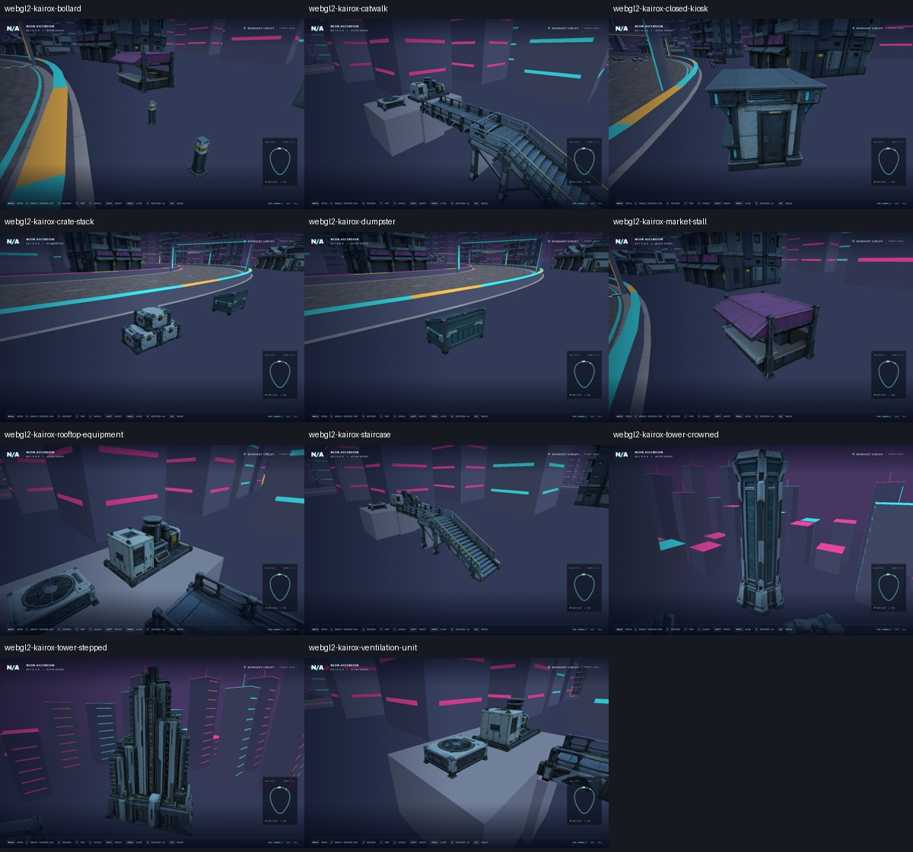

# Kairox city detail kit

The [utility-room and skyline expansion](skyline-expansion.md) adds three models
and now replaces every skyline box: the current kit has 14 models and 164 shared instances.
The original eleven-model production and validation record follows below.

Eleven models generated with built-in ImageGen references and Tripo image-to-model
on 2026-10-21, then integrated into the playable circuit. Twenty shared instances
add market activity, sparse service props, four skyline landmarks and a connected
stair/catwalk/rooftop service assembly beside the transit corridor.



| Model | Instances | Height or span | Triangles |
| --- | ---: | ---: | ---: |
| Market stall | 2 | 3 m tall | 41,643 |
| Closed kiosk | 2 | 3.2 m tall | 43,759 |
| Dumpster | 2 | 1.5 m tall | 43,580 |
| Crate stack | 2 | 1.5 m tall | 45,573 |
| Bollard | 4 | 1.1 m tall | 43,553 |
| Ventilation unit | 1 | 0.85 m tall | 39,491 |
| Stepped residential tower | 2 | 65 m tall | 44,126 |
| Crowned tower | 2 | 80 m tall | 42,249 |
| Staircase | 1 | 5 m including rails | 42,012 |
| Catwalk | 1 | 8 m span | 41,896 |
| Rooftop equipment assembly | 1 | 2.5 m tall | 43,973 |

## Runtime placement and loading

`src/city_kit.cpp` owns game-specific placement, import checks and the supports
for the elevated service assembly. Full footprint circles clear the road centre
by their radius plus at least 14 m; road half-width is 10 m. Props stay behind the
existing barriers and add no driving collision. Existing buildings keep their
own collision. The stair landing joins the raised catwalk, which reaches a
four-metre utility-room roof carrying ventilation and mechanical equipment.

Two tower silhouettes appear twice each at separated road vistas. Their reserved
space excludes nearby procedural towers, preventing the new silhouettes from
being buried in the original skyline. Market and service objects use sparse
authored placements rather than scattering along the entire road.

Each model is imported once and its mesh/maps are shared by its instances.
The browser verifies SHA256 before import; C++ checks triangle count, materials,
parts, measured bounds and bottom-centred origin. Imports stage complete actors
before publishing. Race entry waits for all scene assets, and download retry
preserves previously loaded assets. `src/city_kit_contract.hpp` is generated from
the prepared asset records by the preparation script.

## Production and provenance

Runtime assets and sanitized records are under `assets/runtime/models/city-kit/`.
The 11 files total **30.74 MB**, with 471,855 unique triangles. Each has one mesh
primitive and one PBR material with three embedded maps. Utility props use 512px
maps; towers use 1024px maps. Original full-detail topology and UVs are preserved.
`static_art.hpp` now optimizes index/vertex ordering and generates three shared
distance LODs before publication. The renderer selects levels by projected size;
near views retain the original surfaces. See the measured
[performance fix](performance-diagnosis.md). Physical-mobile performance still
requires device validation.

The [exact ImageGen prompt set](city-kit-prompts.json) follows the existing Kairox
palette. References, prompt hashes and raw resumable provider jobs remain in
ignored `artifacts/model-input-images/kairox-*/` and
`artifacts/model-jobs/kairox-*/`. Per-model runtime records retain the source,
reference and prepared SHA256 hashes, task ID, dimensions and credits. No signed
download URLs or credentials are included in runtime provenance.

Exactly 11 Tripo generations completed, consuming **660 recorded credits**.
No paid retries or segmentation were performed. The first sandbox-blocked image
upload stopped before task submission; its not-submitted checkpoint was continued
with network access. The existing UUID-compatible helper from the vehicle work
was used for provider task persistence. Skill defaults were retained: detailed
geometry, 50k face target, v3.5 detailed PBR textures, AI Complete off and Remove
Lighting off. Account release entitlement remains unverified in the asset records.

Reproduction from retained source jobs (no provider calls):

```powershell
& 'C:/Program Files/Blender Foundation/Blender 3.5/blender.exe' --background --python scripts/prepare-city-kit.py
& 'C:/Program Files/Blender Foundation/Blender 3.5/blender.exe' --background --python scripts/inspect-city-kit.py
python scripts/dev.py native
python scripts/dev.py build
```

## Validation

- Blender imported every prepared GLB, verified embedded texture dimensions and
  rendered front, opposite and side views; all 33 views were inspected.
- Native smoke and chassis-race tests passed. A focused `racing_smoke city-kit`
  run also passed after the final tower-placement adjustment. Checks cover
  malformed/duplicate imports, readiness, resource sharing, bounded instance
  counts and road/building clearance.
- `scripts/city-kit-smoke.cjs` runs real Chromium serially on WebGPU and WebGL2.
  It checks all 11 hashes, rejection and retry of a corrupted model, 20 placements,
  per-model in-scene screenshots and a complete physics-driven hover lap with no
  recovery. Final results are in `build/evidence/city-kit/results.json`.
  Final lap times were 35.27 s on WebGPU and 35.35 s on WebGL2, with no browser
  errors on either backend.

The tested site is a frozen copy at `build/city-kit-site`, built against clean
pinned WebEngine `9b597da84d4582973d010fa9ba3e328c20181892` and Emscripten 6.0.11.
This is desktop-browser evidence, not physical mobile acceptance or a sustained
frame-time budget. The opt-in `?cityReview=0` through `?cityReview=10` camera mode
shows the first placement of each model; normal race cameras are unaffected.




