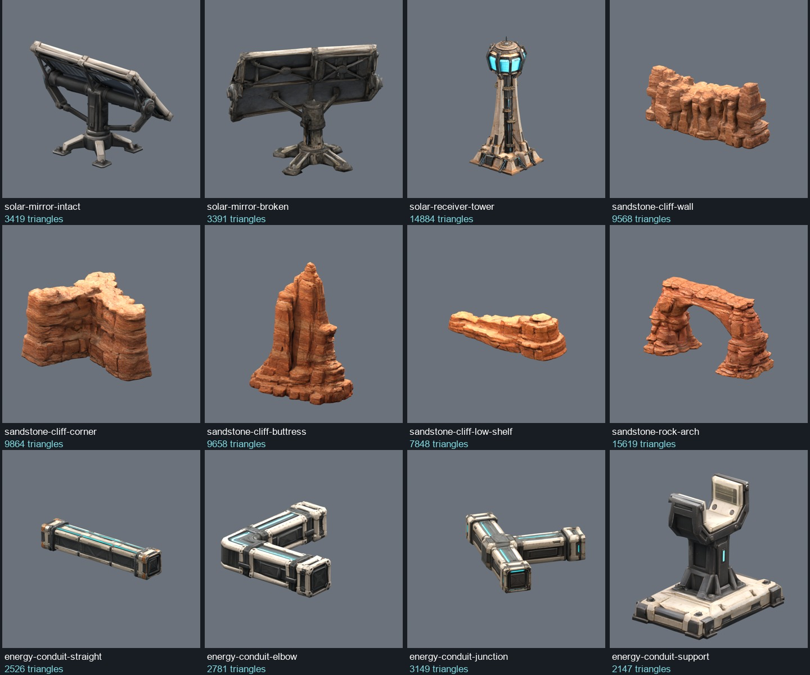
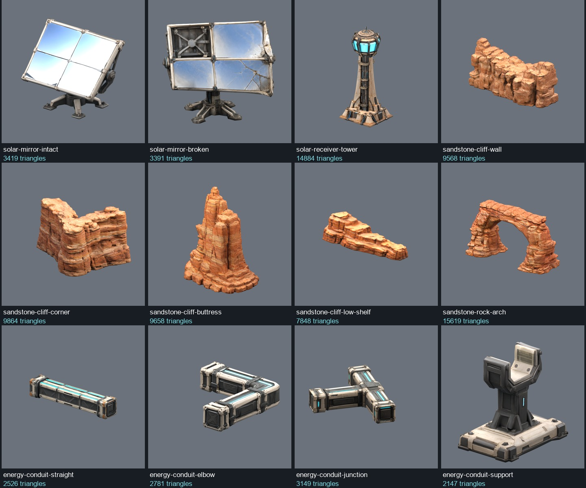

# Desert solar complex model kit

Completed 2026-10-22: 12 Tripo image-to-model generations, prepared GLBs, editable
Blender files and two-view model previews. This is an asset library; the desert
kit is now integrated into the playable [Desert Solar / Helios Run track](desert-solar-track.md).

## Models

Dimensions are width × height × depth in metres. All GLBs use +Y up and a
bottom-centre origin. Geometry is uniformly scaled from the generated meshes.

| Model | Actual triangles | Dimensions (m) | Maximum texture dimension |
| --- | ---: | --- | ---: |
| [solar-mirror-intact](../assets/runtime/models/desert-solar/solar-mirror-intact/solar-mirror-intact.glb) | 3,419 | 6.00 × 4.78 × 3.38 | 1024 |
| [solar-mirror-broken](../assets/runtime/models/desert-solar/solar-mirror-broken/solar-mirror-broken.glb) | 3,391 | 6.00 × 5.70 × 5.96 | 1024 |
| [solar-receiver-tower](../assets/runtime/models/desert-solar/solar-receiver-tower/solar-receiver-tower.glb) | 14,884 | 23.60 × 55.00 × 21.65 | 2048 |
| [sandstone-cliff-wall](../assets/runtime/models/desert-solar/sandstone-cliff-wall/sandstone-cliff-wall.glb) | 9,568 | 20.00 × 9.49 × 9.06 | 2048 |
| [sandstone-cliff-corner](../assets/runtime/models/desert-solar/sandstone-cliff-corner/sandstone-cliff-corner.glb) | 9,864 | 12.00 × 6.56 × 9.71 | 2048 |
| [sandstone-cliff-buttress](../assets/runtime/models/desert-solar/sandstone-cliff-buttress/sandstone-cliff-buttress.glb) | 9,658 | 11.28 × 14.00 × 7.91 | 2048 |
| [sandstone-cliff-low-shelf](../assets/runtime/models/desert-solar/sandstone-cliff-low-shelf/sandstone-cliff-low-shelf.glb) | 7,848 | 16.00 × 4.54 × 5.91 | 2048 |
| [sandstone-rock-arch](../assets/runtime/models/desert-solar/sandstone-rock-arch/sandstone-rock-arch.glb) | 15,619 | 24.00 × 13.31 × 9.79 | 2048 |
| [energy-conduit-straight](../assets/runtime/models/desert-solar/energy-conduit-straight/energy-conduit-straight.glb) | 2,526 | 4.00 × 0.80 × 0.79 | 1024 |
| [energy-conduit-elbow](../assets/runtime/models/desert-solar/energy-conduit-elbow/energy-conduit-elbow.glb) | 2,781 | 3.36 × 0.90 × 3.71 | 1024 |
| [energy-conduit-junction](../assets/runtime/models/desert-solar/energy-conduit-junction/energy-conduit-junction.glb) | 3,149 | 3.99 × 0.90 × 3.97 | 1024 |
| [energy-conduit-support](../assets/runtime/models/desert-solar/energy-conduit-support/energy-conduit-support.glb) | 2,147 | 0.87 × 1.20 × 1.24 | 1024 |

Total: **84,854 triangles**, approximately **94.2 MiB** of prepared GLBs.
Each model passes its requested triangle budget; every model is below 20,000.
The delivered provider source maps were verified at 4096 × 4096. Prepared
exports use 1024 maps for mirrors/conduits and 2048 maps for rocks/tower.

## Materials and preparation

The GLBs embed base colour, metallic/roughness and normal textures. The receiver
crown and conduit strips have cyan-only emissive maps extracted from their
generated base colour. The intact mirror uses a corrected optical normal and
satin metallic material on its panel surfaces to remove jagged provider highlights.
The frame retains the provider PBR maps. No real-time planar reflections are required.

The mirror pivots are represented geometrically; the models are static, with no
articulated tracking rig. Cliff modules are intended to overlap into terrain.
Conduits are separate straight, elbow, T-junction and support models. Their
connectors preserve generated proportions, so exact grid snapping and support
fit remain track-assembly work. Arch clearance and collision must likewise be
measured against the chosen road width before placement.

## Validation

- All 12 provider jobs succeeded and their raw GLBs are retained.
- Checked final GLB structure, SHA256, actual triangle counts, embedded material
  maps and actual exported texture dimensions.
- Re-imported all 12 final GLBs in Blender: finite geometry, embedded images,
  ground-level centred pivots.
- Inspected 24 model renders from opposing views; the rock arch opening is visible
  through both sides, and the broken mirror has the intended missing/cracked tiles.
- No game integration, collision, browser/native runtime or repeated-field
  performance acceptance is claimed. LOD selection belongs to track integration.

## Files and provenance

- Prepared models: `assets/runtime/models/desert-solar/<model>/<model>.glb`.
- Index and measured metadata: [manifest.json](../assets/runtime/models/desert-solar/manifest.json).
- Per-model sanitized provenance: adjacent `<model>.asset.json`.
- Reference prompts: [desert-solar-prompts.json](desert-solar-prompts.json).
- ImageGen references/hash records: `artifacts/model-input-images/desert-solar/<model>/`.
- Original Tripo output, task IDs and source provenance: `artifacts/model-jobs/desert-solar/<model>/`.
- Editable prepared Blender models and QA renders: each model's `qa/` directory.
- Download bundle: `artifacts/desert-solar-model-kit.zip`.
- Preparation/check scripts: `scripts/prepare-desert-solar.py` and `scripts/check-desert-solar.py`.

Built-in ImageGen created one reference per model. The tower reference received
one framing correction before submission; its edit prompt is retained in its
reference record. Tripo used Ultra geometry, textured PBR, triangle topology,
v3.1 geometry and detailed v3.5 textures, AI Complete off and Remove Lighting off.
There was no segmentation stage or paid replacement generation.

Tripo reports **60 credits per model, 720 credits total**. Account entitlement and
release rights remain unverified in the provider provenance.

The approved batch initially reached Tripo's ten-job concurrency limit. The
junction POST received HTTP 429 and was retried only after the ten accepted jobs
completed, consistent with [Tripo's documented rejection behaviour](https://developers.tripo3d.ai/en/docs/rate-limits).
The resulting 12 task IDs are retained. No accepted job was submitted twice.

The isolated helper at `artifacts/desert-tools/tripo.py` preserves the repository
skill's 20,000-triangle ceiling and accepts provider UUID task IDs. Existing
shared skill edits were left untouched. Working source artifacts are ignored by
Git; transfer them deliberately when changing machines.
