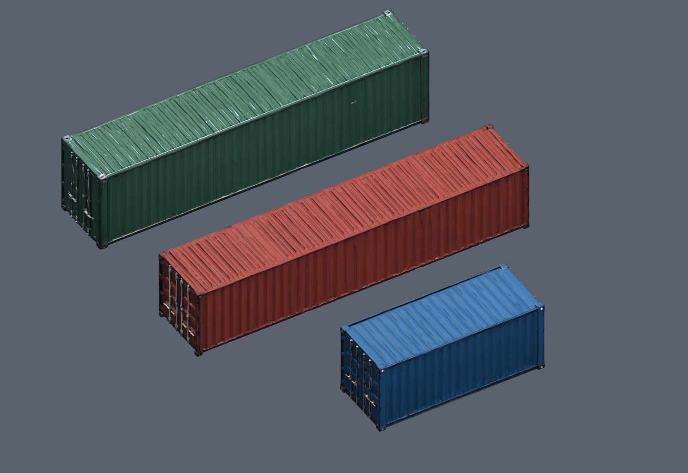
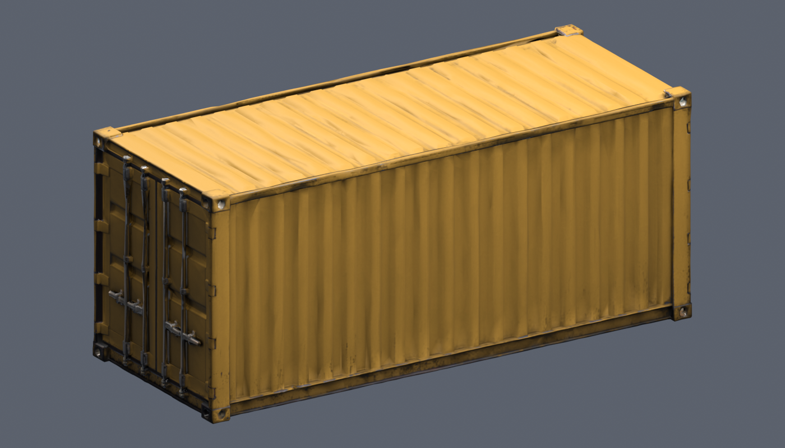

# Dockside Afterdark container kit

Three independent ImageGen-to-Tripo generations, prepared on 2026-11-05.
These are static, closed, weathered freight containers with corrugated sides,
corner castings and detailed locking hardware. Tripo produced door details at
both ends; use them as double-ended containers. Doors are not rigged or operable,
and no interior, collision mesh or LOD chain is supplied.



| Asset | Length × width × height (meters) | Triangles | Initial paint |
| --- | --- | ---: | --- |
| `container-20ft` | 6.058 × 2.438 × 2.591 | 15,756 | Blue `#245D88` |
| `container-40ft` | 12.192 × 2.438 × 2.591 | 17,563 | Red `#913E34` |
| `container-40ft-highcube` | 12.192 × 2.438 × 2.896 | 16,010 | Green `#3E6854` |

Each folder under `assets/runtime/models/dockside-containers/` contains its
self-contained GLB, paint source maps, `asset.json` and `reference.json`.
The GLBs use meters, +Y up, long axis X and a bottom-center pivot. Geometry was
fitted to the dimensions above; these are game props, not manufacturing models.
Each has one material and embedded 2048 × 2048 albedo, normal and metallic/roughness
maps. Provider originals retain their 4096 × 4096 maps under ignored artifacts.
The three GLBs total about 32 MB; source paint maps need not be loaded by the game.

## Changing paint

The editable Blender material is `Dockside_PaintableSteel`. Its **Paint Color**
RGB node changes the shell and painted doors. A soft chromatic mask derived from
the blue references protects neutral hardware, black seals and warm rust. This
is a texture mask, not separate movable metal geometry. Local source files are:

```text
artifacts/dockside-containers/container-20ft/container-20ft.blend
artifacts/dockside-containers/container-40ft/container-40ft.blend
artifacts/dockside-containers/container-40ft-highcube/container-40ft-highcube.blend
```

The portable recoloring command works directly from the committed GLB and its
three companion maps, so it does not require the ignored Blender source file:

```powershell
& 'C:\Program Files\Blender Foundation\Blender 3.5\blender.exe' --background --factory-startup `
  --python scripts/prepare-dockside-containers.py -- `
  --recolor assets/runtime/models/dockside-containers/container-20ft/container-20ft.glb `
  --color '#C99B45' --output artifacts/dockside-containers/custom-ochre.glb
```

Substitute either other model and any six-digit sRGB hex color. The helper also
accepts an editable `.blend` for `--recolor`. It refuses an existing output path.
This exports an ordinary glTF PBR material with the chosen color baked into its
albedo; it does not require a custom renderer shader. Recoloring is an asset
authoring operation, not an installed in-game color picker. Do not multiply the
whole GLB's baseColorFactor to recolor it: that would tint the hardware too.

The color math runs in linear space:

```text
albedo = original * (1 - mask) + paintColor * paintShading * mask
```

Unmasked texels are copied exactly. Paint shading retains the source's surface
variation. The painted regions use dielectric metalness 0.035 and roughness of
at least 0.57; protected hardware keeps its source values. The normal map is
retained, and subsequent color changes preserve the prepared normal/ORM maps.
`original-albedo.png`, `paint-mask.png`, and `paint-shading.png` are the portable
recoloring inputs. `painted-steel-orm.png` is also embedded in the GLB.



## Production and provenance

Built-in ImageGen generated one isolated blue reference per model. Exact prompts
and image SHA-256 values are in each `reference.json`. Tripo settings: geometry
`v3.1-20260211`, Ultra detailed, triangle limit 20,000, texture
`v3.5-20260815`, detailed texture tier, PBR enabled, image autofix disabled and
delight disabled. The actual delivered counts and map dimensions were inspected.

| Asset | Tripo task | Credits |
| --- | --- | ---: |
| 20-foot | `e77b0fcb-f5ae-4f2e-9c29-e244a11c1091` | 60 |
| 40-foot | `094aae65-4207-4b67-b717-eddb2bbd0237` | 60 |
| 40-foot high-cube | `92d32eed-01f4-42bb-8fef-c178c2313c42` | 60 |

Total: 180 Tripo credits, exactly three submitted generation jobs. An initial
sandbox upload attempt stopped with `status=not_submitted`; no generation task
was created by that attempt. No segmentation or replacement generation was used.
Provider entitlement status is retained in each asset record; no release-rights
verification is claimed.

Raw jobs and inputs remain in the original repository's ignored
`artifacts/model-jobs/dockside-container-*` and
`artifacts/model-input-images/dockside-container-*` directories. The short model's
successful job directory is `dockside-container-20ft-v1`. Do not regenerate paid
jobs merely because source artifacts are absent after a machine switch.

To rebuild from those downloaded sources, run Blender with
`--python scripts/prepare-dockside-containers.py -- --source-root <original-repository>`.
Preparation is offline. Editable sources and detailed renders are written to
this checkout's ignored `artifacts/dockside-containers/` directory.

## Validation

Blender 3.5.1 reimported the delivered GLBs and verified actual triangle counts,
dimensions within 0.00002 meters, bottom-center pivots, finite geometry, embedded
2K PBR textures, and their recorded file hashes. Front/reverse views and alternate
paint colors were visually reviewed. The ochre export preserves geometry and
normal/ORM payloads exactly; protected albedo texels are identical after GLB
encoding. The portable GLB recoloring path was also compared with the Blender
source export. See `verification.json` beside the manifest.

The repeatable inspection script is `scripts/review-dockside-containers.py`.
It expects `artifacts/dockside-containers/container-20ft/ochre.glb`, made with
`--color '#C99B45'`, and writes detailed local evidence. The screenshots above
render actual exported GLBs. No scene placement or game code changed. Native
game and WebGPU/WebGL2 acceptance have not been performed for this asset kit.
