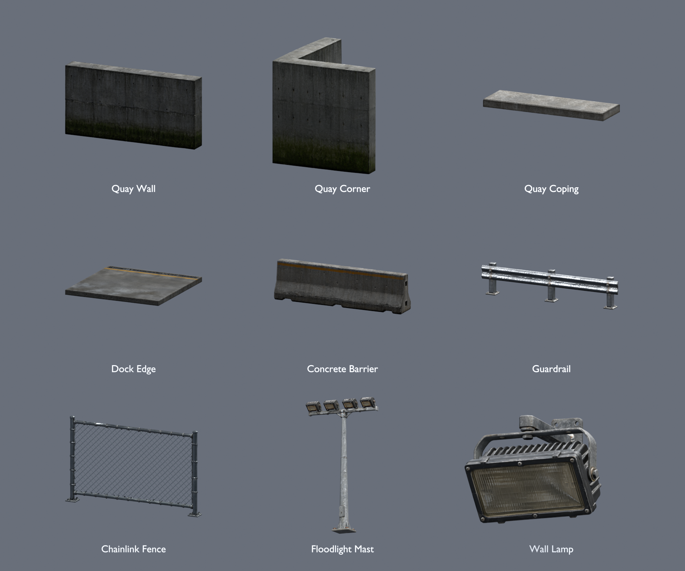
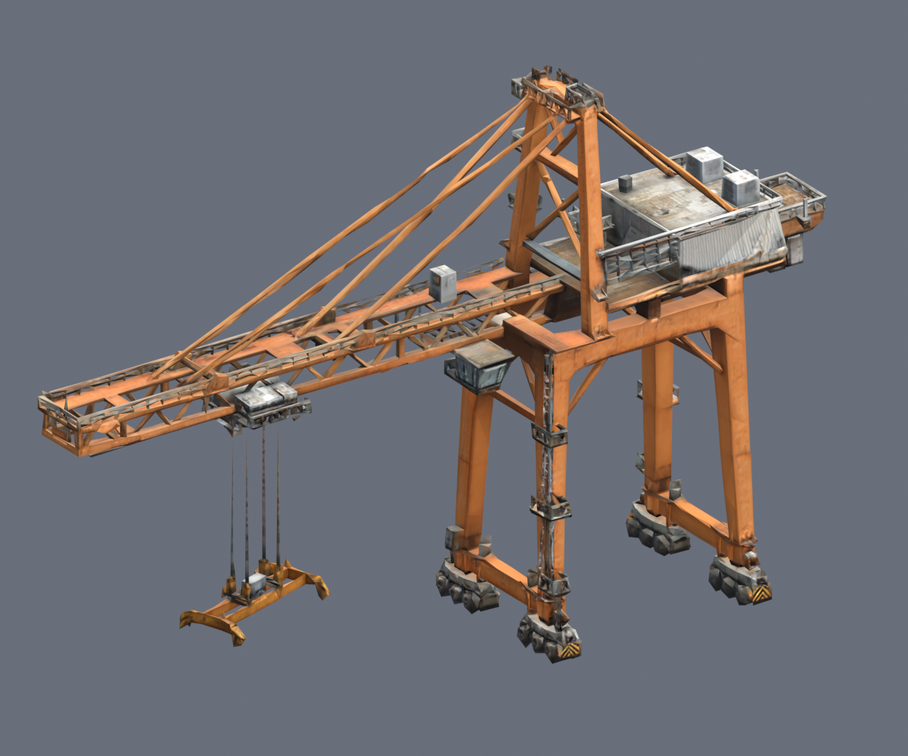

# Dockside Afterdark: quay, barriers, lights and crane

Ten separate textured GLB scenery assets, created from ten built-in ImageGen
references through Tripo. The nine-piece quay/barrier/light kit and the previously
requested container crane are included. No track, gameplay, or engine files change.



The preview above is a Blender render of the exported GLBs. Display sizes are
normalized per cell; use the measured dimensions below for placement.

## Models

Files are in [assets/runtime/models/dockside-harbor](../assets/runtime/models/dockside-harbor/).
Dimensions below are **width × height × depth**, in meters, in exported glTF axes
X × Y × Z. Every root has applied scale and a bottom-center pivot.

| Model | GLB | Dimensions | Triangles |
| --- | --- | --- | ---: |
| Straight quay wall | [quay-wall.glb](../assets/runtime/models/dockside-harbor/quay-wall.glb) | 8 × 4 × 1 | 2,996 |
| Quay corner | [quay-corner.glb](../assets/runtime/models/dockside-harbor/quay-corner.glb) | 4 × 4 × 4 | 3,995 |
| Concrete coping | [quay-coping.glb](../assets/runtime/models/dockside-harbor/quay-coping.glb) | 4 × 0.25 × 1.2 | 995 |
| Dock-edge apron | [dock-edge.glb](../assets/runtime/models/dockside-harbor/dock-edge.glb) | 4 × 0.22 × 4 | 2,995 |
| Concrete race barrier | [concrete-barrier.glb](../assets/runtime/models/dockside-harbor/concrete-barrier.glb) | 4 × 1.1 × 0.7 | 3,996 |
| Steel guardrail | [guardrail.glb](../assets/runtime/models/dockside-harbor/guardrail.glb) | 4 × 0.85 × 0.35 | 17,862 |
| Chain-link fence | [chainlink-fence.glb](../assets/runtime/models/dockside-harbor/chainlink-fence.glb) | 4 × 2.4 × 0.3 | 6,570 |
| Floodlight mast | [floodlight-mast.glb](../assets/runtime/models/dockside-harbor/floodlight-mast.glb) | 6.86 × 12 × 2.19 | 19,247 |
| Warehouse wall lamp | [wall-lamp.glb](../assets/runtime/models/dockside-harbor/wall-lamp.glb) | 0.60 × 0.534 × 0.667 | 18,616 |
| Container gantry crane | [container-crane.glb](../assets/runtime/models/dockside-harbor/container-crane.glb) | 65.57 × 42 × 16.13 | 18,506 |



## Placement and materials

The quay and barrier lengths use a four-meter planning grid. Lay two coping caps
along one eight-meter wall; the wall top is at Y=4 and the cap top at Y=4.25.
Place dock slabs with their walking surface at the chosen dock elevation. The
corner is an L-shaped exterior wall with an open inside, not a solid square block.
AI-authored end surfaces and corner thickness are approximate: align the exposed
face and use a small overlap/covered joint when assembling the waterfront.
The bounding envelopes are calibrated, but watertight grid joins are not claimed.

Guardrail and lamp fronts face +Z after export. All props use bottom-center pivots;
the wall lamp's mounting plate is part of the mesh and requires a wall offset.
The crane's long boom runs along X. It is a static landmark with four support legs,
truss boom, machinery, cables and an empty suspended spreader, without an animation rig.

Base color, normal, and metallic/roughness maps are embedded in each GLB. The five
concrete assets use rebaked 1024-square PBR maps after mesh reduction. The other
five retain the provider UVs with maps capped at 2048 square. Original Tripo maps
were inspected at 4096 square. Fine details are intended for scenery use; the
guardrail, lamps and crane retain their source geometry within the 20k limit.

The fence uses actual geometry for its open diamond pattern, with no alpha-blended
sheet. Its irregular generated interior wires were replaced locally while keeping
the textured Tripo posts and rails. The replacement wire has a separate
`Galvanized_chainlink_wire` PBR material.

The lamp lenses have warm-tinted PBR surfaces. Emissive masks, light entities,
collision shapes, LODs and game scene placement are not included. Configure these
when integrating the kit and profile the dense light/guardrail meshes if repeated
many times. No WebGPU, WebGL2 or native game acceptance is claimed for these assets.

## Sources, regeneration and verification

Each model has a sanitized `.asset.json` with provider task ID, settings, source
and output hashes, measured triangle count, source map sizes and credit use.
The adjacent `.reference.json` stores the exact built-in ImageGen prompt and image
hash. [manifest.json](../assets/runtime/models/dockside-harbor/manifest.json) indexes
the kit; [verification.json](../assets/runtime/models/dockside-harbor/verification.json)
records the checks on the exported files.

Ten successful Tripo jobs consumed **600 credits**: 540 for the nine-piece kit and
60 for the earlier crane request. There were no paid retries or segmentation jobs.
Account entitlement/release rights remain unverified in the provider provenance.

The machine-local generation repository retains each original reference at
`artifacts/model-input-images/dockside-<id>/` and each resumable Tripo job/raw GLB
at `artifacts/model-jobs/dockside-<id>/`. Editable `.blend` files and front/back
renders are in this checkout's ignored `artifacts/dockside-harbor/` directory.
Transfer those ignored sources deliberately before changing machines.

Offline preparation and inspection, with Blender 3.5 or later:

```text
blender --background --factory-startup --python scripts/prepare-dockside-harbor.py -- --source-root PATH_TO_GENERATION_REPOSITORY
blender --background --factory-startup --python scripts/review-dockside-harbor.py
```

Preparation uses shared offline helpers from `prepare-dockside-warehouses.py`.
It welds source seam vertices before decimating concrete meshes and rebakes their
PBR maps onto new UVs. `--only <asset-id> ...` resumes local preparation without
new provider calls.

Verification reimports all ten final GLBs and checks their SHA256, embedded maps,
texture dimensions, finite vertex coordinates, meter bounds, bottom pivots and
actual triangle counts. Opposite views are rendered for every asset, with extra
low/side views for lamps. A sampled ray test verifies that the fence interior is
predominantly open. Visual review covers the quay's L-shaped corner, drainage
detail, barrier profile, fence frame, lamp faces, and crane silhouette/cables.
