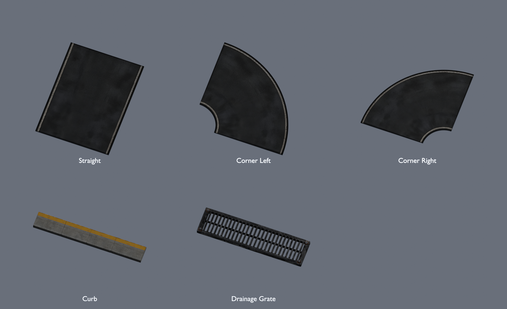
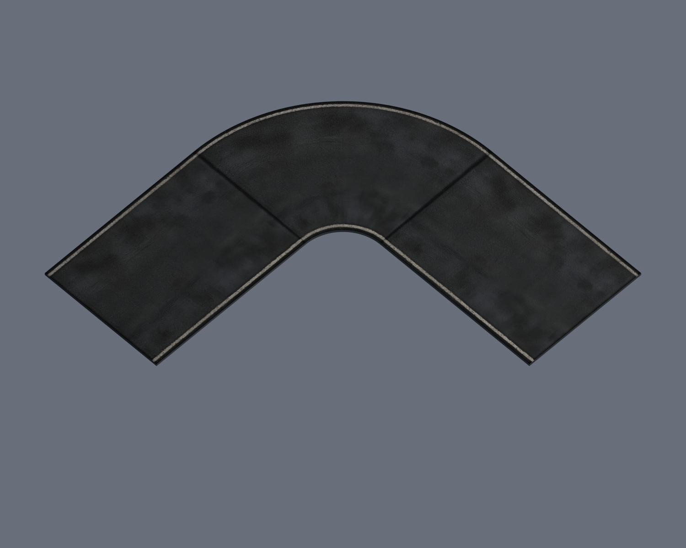

# Dockside Afterdark track surfaces

Five static GLB models for rain-dark waterfront roads, generated from four ImageGen references through Tripo and finished offline in Blender. Assets are in `assets/runtime/models/dockside-track-surfaces/`.



| Model | Dimensions X × Y × Z (meters) | Triangles |
| --- | --- | ---: |
| Waterfront straight | 12 × 0.25 × 16 | 12 |
| Tight corner, left | 16 × 0.25 × 16 | 1,296 |
| Tight corner, right | 16 × 0.25 × 16 | 1,296 |
| Yellow-striped concrete curb | 4 × 0.15 × 0.6 | 1,796 |
| Open-slot drainage grate | 2 × 0.12 × 0.5 | 5,996 |

## Placement

GLBs use meters, Y up, and bottom-center pivots. Road width is 12 meters; road tops are at local Y = 0.25. Corners turn 90 degrees with inner radius 4 meters, outer radius 16 meters, and centerline radius 10 meters. The corner bounding box includes empty space inside the bend.

`example-layout.json` contains a verified straight–left corner–straight assembly with translations and rotations in glTF coordinates. Per-asset JSON includes joining centers. Road geometry meets at a common height; baked dark end borders remain visible as surface joints.



Place a curb on the road with its base at Y = 0.25, making its top Y = 0.40. A grate base at Y = 0.13 puts its highest surface at Y = 0.25. Grates require a matching recess or shoulder opening; placing one on the uncut road slab will obscure the open slots. Curbs are straight sections, not curved curb pieces.

## Generation and materials

Four successful Tripo source jobs consumed 60 credits each: **240 credits total**. The right corner is an offline mirrored derivative and consumed no extra credits. Provider task IDs, source/reference hashes, settings, costs and exact reference prompts accompany the GLBs. Original provider outputs remain under the generation repository's ignored `artifacts/model-jobs/dockside-*/` directories; reference images are under `artifacts/model-input-images/`.

Sources used Tripo geometry `v3.1-20260211`, detailed geometry with a 20,000-face limit, detailed PBR textures and texture model `v3.5-20260815`. Each downloaded source has fewer than 20,000 triangles and original 4096-pixel maps. Runtime files embed 1024-pixel base color, normal and packed occlusion/roughness/metallic maps. Asphalt is a rough dielectric with reduced normal strength. Road sidewalls and undersides use a separate constant substrate material.

The straight was rebuilt as an exact flat slab and its Tripo material rebaked. The generated corner had distorted geometry and UVs, so its production mesh was rebuilt as an exact quarter annulus and uses the straight's PBR material bent around the curve. The original corner source is retained for provenance. Both corners share the straight's visual treatment; they are not untouched provider meshes. The curb and grate retain reduced provider geometry with rebaked maps. Editable Blender files and individual review renders are under ignored `artifacts/dockside-track-surfaces/` in this worktree.

## Verification and scope

The review script reimported all five exported GLBs and checked hashes, embedded PBR maps, texture dimensions, meter bounds, bottom pivots, finite coordinates and triangle counts. It verified 255 road-top ray samples at Y = 0.25, corner inner/outer clearance, and 20 ray samples across the two assembled seams. Grate sampling found 58.125% open space within the sampled interior. Front, back and top renders were inspected, along with the assembled road preview. Results are in `verification.json` and `example-layout.json`.

These are asset deliverables. Race placement, road collision, grate recess geometry, wet-weather shaders and gameplay integration are not implemented here. Native or browser runtime acceptance has not been performed for this asset-only change.

## Reproduction

Requires Blender with its bundled NumPy and the inherited `scripts/prepare-dockside-warehouses.py` helper. Set `SOURCE_REPO` to the repository containing the four saved provider outputs and reference records. Run from this checkout:

```powershell
& 'C:/Program Files/Blender Foundation/Blender 3.5/blender.exe' --background --factory-startup --python scripts/prepare-dockside-track-surfaces.py -- --source-root $env:SOURCE_REPO
& 'C:/Program Files/Blender Foundation/Blender 3.5/blender.exe' --background --factory-startup --python scripts/review-dockside-track-surfaces.py
```

Preparation processes the straight before the corner because the corner uses its material. Check logs for Python exceptions as well as the process exit status. Neither script submits provider jobs or reads credentials.
