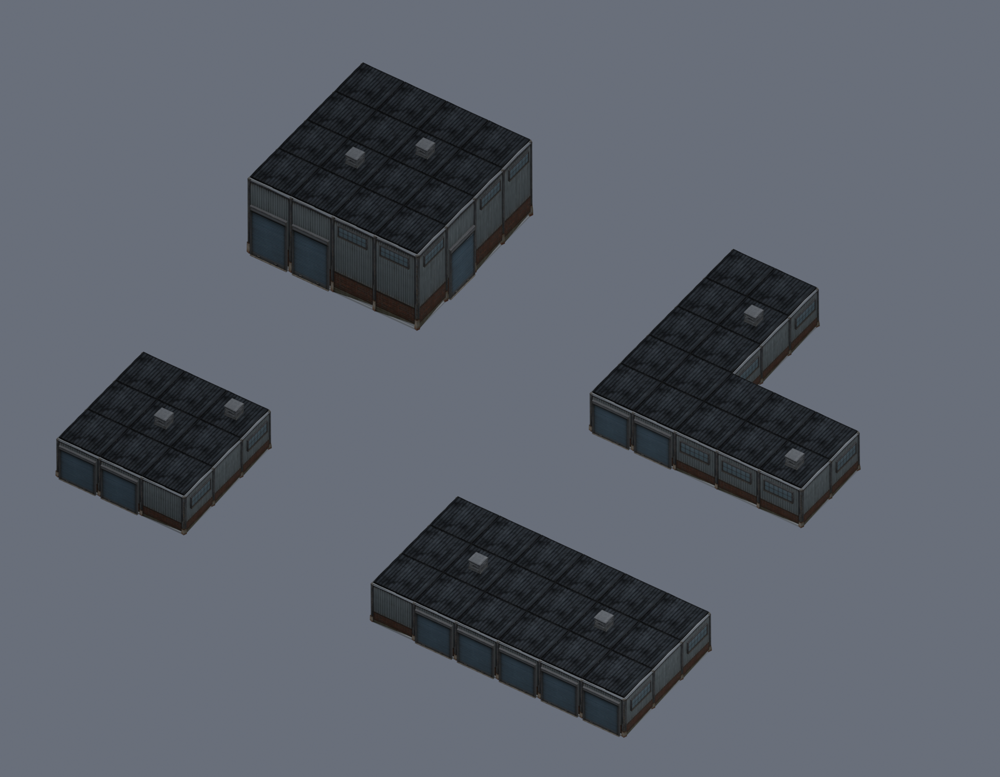

# Dockside Afterdark modular warehouses

Six independently generated Tripo components form four assembled warehouse
exteriors. They share weathered corrugated steel, brick bases, dark roofing,
closed loading shutters, steel window banks and louvered roof vents.



## Complete warehouses

Files are under `assets/runtime/models/dockside-warehouses/warehouses/`.
Each self-contained GLB retains named component nodes with shared meshes and
materials. The adjacent `.assembly.json` records every component and transform.

| Model | Nominal footprint | Wall height | Rendered triangles | Loading doors |
| --- | --- | --- | ---: | ---: |
| `compact-depot.glb` | 12 × 12 m | 4 m | 12,269 | 2 |
| `long-freight-shed.glb` | 24 × 12 m | 4 m | 19,958 | 5 |
| `high-bay-store.glb` | 16 × 16 m | 8 m | 18,359 | 3 |
| `l-shaped-transfer.glb` | 20 × 20 m outer envelope, L footprint | 4 m | 19,583 | 3 |

The high-bay building uses taller wall/post instances, elevated windows and
5.4-meter loading-door assemblies. The transfer building leaves a 12 × 12 m
corner courtyard open and places a loading door on its inner face. All four
have two rooftop vents. Foundation, roof and vents increase total height to
approximately 5.41 m or 9.41 m. Frames, posts and facade inserts extend beyond
the nominal footprint; exact bounds are in each assembly record.

The triangle counts include every repeated component instance, not just the
unique meshes stored in the file. Each warehouse uses nine shared meshes and
seven materials. Each GLB is about 10.7 MB and embeds its textures.

## Reusable components

Files are under `assets/runtime/models/dockside-warehouses/modules/`.
`<name>.glb` is the more detailed standalone version; `<name>-assembly.glb` is
the lighter version used by the complete buildings. Both versions have baked
1024 × 1024 albedo, tangent normal and metallic/roughness textures. They preserve
the Tripo source appearance through UV rebaking rather than applying its old
texture atlas directly to collapsed geometry.

| Component | Width × depth × height | Detail triangles | Assembly triangles |
| --- | --- | ---: | ---: |
| `wall` | 4 × 0.30 × 4 m | 1,793 | 413 |
| `corner` | 0.42 × 0.42 × 4 m | 496 | 116 |
| `roof` | 4 × 4 × 0.22 m | 896 | 176 |
| `door` | 3.5 × 0.22 × 3.6 m | 1,996 | 646 |
| `vent` | 1.2 × 1.2 × 1 m | 1,195 | 755 |
| `window` | 2.8 × 0.18 × 1.2 m | 1,195 | 235 |

The kit uses a four-meter grid. GLBs use meters, +Y up and +Z facade front.
Module pivots are at bottom center. Assembly origins are at ground level and
the center of the nominal footprint's bounding rectangle. Assembly JSON
translations/scales use glTF XYZ axes; rotations are degrees around +Y.

Corners also act as structural posts between wall bays. The assembly script
adds simple authored concrete foundations and inner wall/roof backing plates
to close small edge irregularities in the generated modules. Those supports
are not additional Tripo generations. Roofs are flat corrugated cassettes;
gable roofs are not included.

These are exterior scenery assets. Loading doors are closed facade inserts,
windows have opaque glass, and neither is rigged to open. There are no playable
interiors, collision components, interactive doors, or game scene placements.
Material tint controls were not added to this warehouse kit.

## Editing and rebuilding

Local editable Blender assemblies are under
`artifacts/dockside-warehouses/warehouses/<model>.blend`. They retain separate
named instances, so wall bays, doors, windows and vents can be rearranged.
Editable component scenes are under `artifacts/dockside-warehouses/modules/`.
These source scenes are ignored working artifacts; the GLBs and assembly
definitions are committed.

To regenerate the four assembled GLBs and editable scenes entirely offline
from the committed low-detail components:

```powershell
& 'C:\Program Files\Blender Foundation\Blender 3.5\blender.exe' --background --factory-startup `
  --python scripts/prepare-dockside-warehouses.py -- --assemble-only
```

The `BUILDINGS` definitions in that script control occupied grid cells, height,
door bays, window distribution and vent positions. To rebuild the components
from the downloaded Tripo originals as well, replace `--assemble-only` with
`--source-root <repository-containing-the-raw-jobs>`. `--modules-only` prepares
just components; `--start-at <component>` resumes offline preparation after
previous components have been successfully prepared. None of these commands
contacts Tripo or buys generations.

Raw downloads, resumable job records and ImageGen inputs remain under the
original repository's ignored `artifacts/model-jobs/warehouse-<component>/`
and `artifacts/model-input-images/warehouse-<component>/` directories.
Do not create replacement paid jobs merely because those files are absent on
another machine. The committed modules suffice to rebuild the assemblies.

## Provenance and verification

Built-in ImageGen created six separate isolated reference images. Exact prompts
and SHA-256 hashes are recorded in `modules/<component>.reference.json`.
Tripo used geometry `v3.1-20260211`, Ultra detailed, texture `v3.5-20260815`,
detailed texture tier, PBR enabled, triangle limit 20,000, autofix disabled and
delight disabled. All six originals delivered 4K maps and fewer than 20,000
triangles. Each generation consumed 60 credits: **360 Tripo credits total**.
No whole-warehouse generation, paid segmentation or replacement job was used.
Task IDs, source/output hashes and provider entitlement status are retained
in each component's `.asset.json`.

Offline preparation welds geometric seams before simplification, recomputes
normals after normalization, unwraps the reduced meshes and rebakes source PBR
onto the new UVs. Both standalone and assembly versions were visually checked.

`scripts/review-dockside-warehouses.py` reimports all twelve module GLBs and the
four warehouse GLBs. It verifies measured dimensions, ground pivots, triangle
counts including instances, finite geometry, embedded texture dimensions and
PBR maps, file hashes, and every component's placement. It also ray-tests actual
exported geometry: 1,125 roof/wall coverage probes passed, and all nine empty
cells in the L-shaped courtyard remain clear. These sampled checks do not
constitute a watertight-solid or gameplay-collision guarantee.

The actual exported buildings were rendered from front and rear for review.
Machine-readable results are in `assets/runtime/models/dockside-warehouses/verification.json`;
detailed local renders are in `artifacts/dockside-warehouses/verified/`.
No game code or engine dependency changed. Native game and WebGPU/WebGL2
acceptance were not run for these unplaced asset files.
