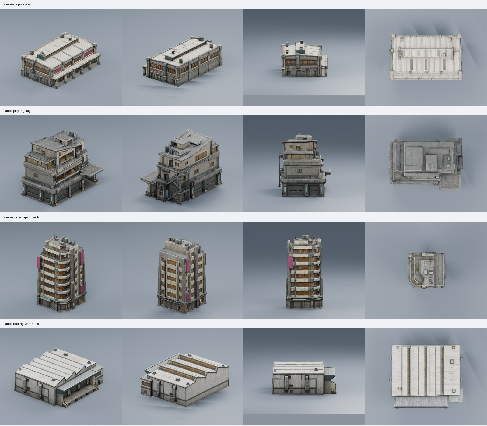

# Four additional Kairox buildings

Created 2026-10-21 using four built-in ImageGen references and four successful
Tripo image-to-model jobs. All four are now installed around the racing circuit,
replacing four repeated buildings; see [building integration](building-integration.md).



| Building | Intended use | Height | Triangles | Prepared GLB |
| --- | --- | ---: | ---: | --- |
| Shop arcade / covered market hall | Market-bend frontage with sheltered shop bays | 12 m | 41,822 | [5.10 MB](../assets/runtime/models/buildings/kairox-shop-arcade/kairox-shop-arcade.glb) |
| Player garage over charging station | Home-base exterior with workshop, charging canopy and upper rooms | 14 m | 42,187 | [4.71 MB](../assets/runtime/models/buildings/kairox-player-garage/kairox-player-garage.glb) |
| Corner apartments | Narrow residential variant with stepped terraces | 30 m | 41,601 | [4.86 MB](../assets/runtime/models/buildings/kairox-corner-apartments/kairox-corner-apartments.glb) |
| Loading warehouse | Service-road/loading-plaza frontage with dock and dispatch office | 11 m | 41,314 | [4.77 MB](../assets/runtime/models/buildings/kairox-loading-warehouse/kairox-loading-warehouse.glb) |

The four prepared files total 19.43 MB and 166,924 triangles. Their XYZ
dimensions are respectively 19.30 x 12.00 x 30.75 m, 13.27 x 14.00 x 18.26 m,
15.18 x 30.00 x 15.96 m and 26.61 x 11.00 x 30.54 m. Scale is uniform;
reference proportions are interpreted by Tripo rather than exact architectural
measurements. Each GLB uses +Y up and a bottom-centred footprint origin.
Facade direction remains asset-specific and must be oriented during placement.

## Preparation and verification

All originals contain three embedded 4096 x 4096 texture maps. Prepared copies
retain source geometry and UVs, with embedded base-color, normal and ORM maps
reduced to 1024 x 1024. Each contains one mesh object and one material.
The original GLBs remain under `artifacts/model-jobs/<asset>/model.glb`.
The preparation script supports all four asset names:

```powershell
& 'C:/Program Files/Blender Foundation/Blender 3.5/blender.exe' --background --python scripts/prepare-buildings.py -- kairox-shop-arcade
```

Blender 3.5.1 imported and exported all four models successfully. The exported
files were reimported and rendered from a three-quarter view, the opposite
side, a side view and above. All sixteen images were visually inspected.
Checks verified output hashes, retained triangle counts, target heights,
embedded texture sizes and ground origins. The retained inspection helper is
`artifacts/model-jobs/building-tools/inspect_model.py`; per-model evidence is in
`artifacts/model-jobs/<asset>/runtime-qa/`.

The arcade keeps its covered frontage and clerestory roof; the garage keeps
its stepped rooms, external stair and charging canopy; the apartments keep
their corner balconies and stepped roof; the warehouse keeps its sawtooth
roof, loading dock and office. Fine railings and facade details are simplified
by reconstruction. These are exterior scenery assets; functional interiors,
doors, charging equipment, collision, LODs and night-emission masks are not
provided by the GLBs themselves. The game adds simple box collision and scene
placement; browser evidence is recorded in the building integration document.

## Generation and provenance

| Asset | Tripo task | Credits |
| --- | --- | ---: |
| `kairox-shop-arcade` | `97af2ac0-8485-45d7-8d16-27830111e742` | 60 |
| `kairox-player-garage` | `e0dc29d6-0d28-48d5-9885-57541d7defa4` | 60 |
| `kairox-corner-apartments` | `defb8400-6253-4285-86f8-4c706d8058c2` | 60 |
| `kairox-loading-warehouse` | `475c58db-1a05-483c-b23c-4e8f1e238c5b` | 60 |

Total recorded cost: **240 credits**, exactly four generation jobs, without paid
retries or segmentation. Settings were detailed v3.1 geometry, 50,000 face
target, detailed v3.5 textures, PBR, triangles, AI Complete off and Remove
Lighting off. The existing UUID-compatible helper in
`artifacts/model-jobs/vehicle-tools/` was used; its 17 offline tests passed.

References were generated with built-in ImageGen, copied into the repository,
and inspected before submission. Each prompt asks for one complete building in
a neutral studio three-quarter view, with Kairox's worn concrete, ivory panels,
amber glazing and restrained teal accents. The exact prompt set is retained at:

- [Shop arcade prompt](../artifacts/model-input-images/kairox-shop-arcade/prompt-v1.txt)
- [Player garage prompt](../artifacts/model-input-images/kairox-player-garage/prompt-v1.txt)
- [Corner apartment prompt](../artifacts/model-input-images/kairox-corner-apartments/prompt-v1.txt)
- [Loading warehouse prompt](../artifacts/model-input-images/kairox-loading-warehouse/prompt-v1.txt)

Each reference folder contains `reference-v1.png` and `provenance-v1.json`.
Provider job checkpoints and original provenance remain beside the source GLBs.
Reference and job folders are ignored working files; sanitized `.asset.json`
records are beside the prepared GLBs. Provider account entitlement and release
rights remain unverified, as recorded in those sidecars.
