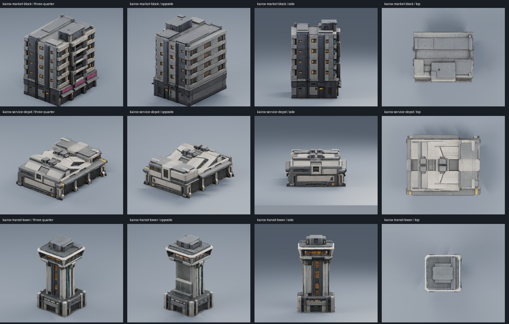

# Kairox trackside buildings

Created 2026-10-21 with built-in ImageGen references followed by three Tripo
image-to-model generations. All three types are now placed around the live race
circuit; see [building integration and validation](building-integration.md).



| Building | Intended placement | Height | Triangles | Prepared GLB |
| --- | --- | ---: | ---: | --- |
| Market apartment block | Market bend, shops along the race corridor | 24 m | 38,157 | [4.69 MB](../assets/runtime/models/buildings/kairox-market-block/kairox-market-block.glb) |
| Charging/service depot | Service straight or charging yard | 10 m | 41,632 | [4.41 MB](../assets/runtime/models/buildings/kairox-service-depot/kairox-service-depot.glb) |
| Transit control tower | Station approach or skyline braking landmark | 32 m | 40,455 | [4.53 MB](../assets/runtime/models/buildings/kairox-transit-tower/kairox-transit-tower.glb) |

## Preparation and inspection

Prepared copies use metres, +Y up, and a root at the bottom centre of the
footprint. Scale is uniform. Dimensions in XYZ are approximately 16.32 x 24 x
19.91 m, 18.81 x 10 x 22.99 m, and 16.28 x 32 x 15.88 m respectively.
Orient the shop/garage facade toward the track during placement; facade
orientation is not a common +Z-forward contract.

Each model has one mesh/material with embedded base color, normal and ORM maps.
Original maps are 4096 x 4096; prepared maps are 1024 x 1024. The three prepared
files total 13.63 MB. Original triangle counts and texture seams are preserved.
An 8k collapse trial visibly damaged facade textures and was rejected. These
are detailed assets, above the repeating street-module budget; create baked
LODs and profile before dense instancing along an entire circuit.

`scripts/prepare-buildings.py` reproduces the offline normalization and texture
reduction from the retained source jobs. Example:

```powershell
& 'C:/Program Files/Blender Foundation/Blender 3.5/blender.exe' --background --python scripts/prepare-buildings.py -- kairox-market-block
```

Both original and prepared GLBs import and render with their embedded maps in
Blender 3.5.1. Front three-quarter, opposite, side and top views were inspected.
Prepared output checks confirm unchanged triangle counts, three 1K maps and
bottom-centred bounds. Gameplay placement and simple collision are now implemented
and checked on WebGPU/WebGL2. Emissive window tuning, baked LODs and dense-city
performance profiling remain future work.
Window/light appearance currently comes from provider materials, without a
separate authored night-emission mask.

## References and provenance

The ImageGen prompts describe a complete isolated building in neutral studio
lighting, consistent graphite concrete/ivory metal with amber and teal accents.
The apartment block adds recessed shops and faded magenta sign panels; the depot
uses three closed service bays and sawtooth roofing; the tower uses a concrete
shaft and wider glazed control room. No text, people, vehicles or scenery were
requested in the references.

Exact built-in ImageGen prompt sets and retained references:

- [Market block prompt](../artifacts/model-input-images/kairox-market-block/prompt-v1.txt)
- [Service depot prompt](../artifacts/model-input-images/kairox-service-depot/prompt-v1.txt)
- [Transit tower prompt](../artifacts/model-input-images/kairox-transit-tower/prompt-v1.txt)

Each reference folder also contains `reference-v1.png` and `provenance-v1.json`
with the image hash and source design documents. Each raw job is retained at
`artifacts/model-jobs/<asset>/` with `model.glb`, `job.json`, provider provenance,
`qa.json`, and four rendered views. Prepared verification is in its `runtime-qa/`
subfolder. These working files are ignored; prepared GLBs and sanitized
`*.asset.json` records are under `assets/runtime/models/buildings/`.

| Asset | Recorded successful Tripo task | Credits |
| --- | --- | ---: |
| Market block | `b8a698b3-1589-419a-ba0c-138041ca4561` | 60 |
| Service depot | `37729d10-8417-46bc-883a-f5995a81090a` | 60 |
| Transit tower | `2587bf0f-0f0e-470c-a37b-8a23a77c2eee` | 60 |

Generation used skill defaults: detailed v3.1 geometry, 50k face target, detailed
v3.5 textures, PBR, triangles, AI Complete off and Remove Lighting off. Exactly
three generations completed, with no paid retries or segmentation. The isolated
UUID-compatible helper from the vehicle work was reused; all 17 offline helper
tests passed outside the sandbox after a sandbox temporary-folder access failure.
Account entitlement and release rights remain unverified in the asset records.
