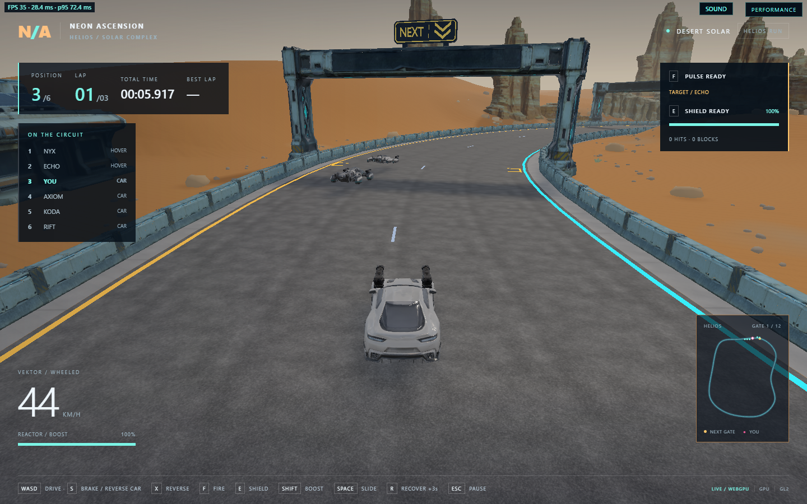

# Next-gate sign

The active checkpoint has a crisp amber NEXT legend, double downward chevrons,
a chamfered graphite enclosure and two short mounting feet. It sits on the
gantry crossbeam. Small amber road-edge brackets identify the crossing close up.

The old generated chevron was placed at a fixed 4.2 m above the road, with no
connection to gantry geometry. This left it hanging in the opening, especially
under the desert gantry's 1.5x vertical scale.

## Placement and lifecycle

Each infrastructure kit measures the central beam top from its imported source
mesh before LOD preparation. Outboard column caps are excluded. The desert kit
applies its actual vertical scale; Kairox caches separate finish and checkpoint
heights. `GateMarker::present` uses the corresponding height for the next gate.

Feet extend 0.25 m into the beam to accommodate its irregular surface; the
enclosure starts 0.40 m above the measured top. The sign remains centered on
the gate, faces approaching traffic, and never occupies the driving aperture.
Road brackets retain their original ground position. No colliders are added.
An unloaded gantry cannot display a floating marker.

The measured beam tops are approximately 10.56 m for Desert Solar, 7.69 m for
Kairox's finish and 7.99 m for Kairox checkpoints. These are measured results,
not hard-coded placement constants.

One actor follows `RaceProgress::nextGate`; it cannot advance race progress.
Ordered crossings move it, including the finish line. Reverse/skipped crossings
and recovery preserve the target. It is visible in countdown/racing, stable
during pause and hidden in the garage, replay and after finishing.

Normal depth testing and chase-camera framing are retained, including brief
occlusion by city overhead structures. As the car gets directly underneath a
tall gantry, the sign leaves the top of the view; the road brackets and minimap
continue to identify the crossing.

## Reproducible asset

- Script: `scripts/prepare-gate-marker.py`, run with Blender 3.5 in background.
- Runtime: `assets/runtime/models/navigation/next-gate-beacon/next-gate-beacon.glb`.
- SHA-256: `5076e3ed6c07659a3047e34be789d653c1a772bd5a6124f88ba1413c76260631`.
- 696 triangles, 46,132 bytes; two materials and no textures.
- Dimensions: 5.60 x 2.45 x 0.49 m, +Y up, front -Z, bottom-centered feet.
- Separate constant-emission face geometry keeps the enclosure dark in both
  WebGPU and WebGL2, without emissive-mask dependencies or atlas blur.

This is locally authored geometry, with no new provider generation or external
fonts. The previous Tripo source and provenance remain archived under
`artifacts/model-jobs/next-gate-beacon-funded/`; its ImageGen reference remains
under `artifacts/model-input-images/next-gate-beacon/`.

The asset queue still verifies SHA-256. Import checks material/primitive counts,
triangles and bounds before publishing an actor. Failed loads prevent race
readiness and can be retried without duplicate actors.

## Verification

Native targets `racing_gate_marker`, `racing_desert_race_kit` and
`racing_track_kit` cover both circuits, the three gantry geometries, scaled
mount heights, clear driving apertures, atomic import/retry, all twelve targets
over three laps, reverse/skip/recovery, finish hiding and restart.

Browser acceptance scripts accept `TRACK=desert|kairox`, `DEMO_URL` and
`EVIDENCE_DIR`:

- `scripts/gate-marker-smoke.cjs`: both renderers, corrupt download/retry, every
  gate during a real driven lap, target consistency, pause, recovery and restart.
- `scripts/gate-marker-camera.cjs`: normal car chase views at 50/30/18 m and
  a 900x600 approach view; no camera overrides.

Evidence is saved under `build/evidence/gate-marker-mounted-desert/` and
`build/evidence/gate-marker-mounted-kairox/`.

On 2026-10-22, all three native targets passed. Chrome 155 browser runs on the
generated site at port 8117 passed the retry/lifecycle checks with no page or
console errors:

| Track | Renderer | Targets checked | Valid driven lap, no recovery |
| --- | --- | --- | --- |
| Desert Solar | WebGPU | 12/12 | 60.917 s |
| Desert Solar | WebGL2 | 12/12 | 60.150 s |
| Kairox | WebGPU | 12/12 | 35.800 s |
| Kairox | WebGL2 | 12/12 | 35.633 s |

The queue reported the final sign hash on all four runs. `tested-build.json`
records hashes of the served Wasm, JavaScript and sign, compared with the
generated files. Concurrent game work subsequently rebuilt Wasm/JavaScript;
`final-served-build.json` records that later site. Final car-camera runs on both
tracks and backends still loaded the same sign hash and verified its mount,
including 900x600 approach captures. This is desktop browser acceptance, not a
performance benchmark.
