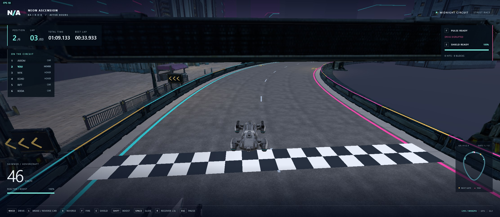

# Kairox frame-rate diagnosis — 2026-10-21

For the later laser-preview 10–20 FPS report, see [GPU selection and stutter](stutter-diagnosis.md).
That investigation verified the game's actual adapter request and compared the
unchanged build on Intel UHD 770 versus the available RTX 5060 Ti.

The live in-app game showed 18 FPS at investigation start. The dominant issue
is GPU rendering cost, with full-scene planar reflections for small damp plaza
patches as the strongest measured contributor. Dense generated props without
derived LODs and large uncompressed textures add further cost.

## Evidence

The running site uses pinned WebEngine
`9b597da84d4582973d010fa9ba3e328c20181892`, Release, WebGPU. A separate Chrome
diagnostic browser selected Intel `gen-12lp` and rendered at 2223 × 966, DPR 1.
The in-app canvas was 2223 × 964. Both were on the same machine/GPU, so the
diagnostic browser's absolute FPS is not a forecast for the in-app game.

The fixed-camera, paused-simulation diagnostic submitted:

| Pass | Draws/frame | Triangles/frame |
| --- | ---: | ---: |
| Planar water reflection | 702 | 6,648,857 |
| World | 342 | 2,297,068 |
| Background | 1 | 1 |
| Total | 1,045 | 8,945,926 |

Temporarily suppressing only reflection draw calls increased measured FPS from
5.38 to 10.52. Suppressing reflection plus draws over 10,000 triangles gave
10.91 FPS. Restoring the baseline gave 3.95 FPS; shared GPU load/thermal variation
limits precise speedup claims. The reflection accounts for 74% of submitted
triangles and 67% of draw calls, and its disproportionate cost is established
independently by the source path.

A broader exploratory run measured 5.4 FPS baseline, 50.1 with all GPU draws
suppressed, 5.9 with HUD updates suppressed, 5.8 with simulation paused, and
10.3 at one-quarter the pixel count. That run had moving AI/camera conditions,
so use it to classify the bottleneck, not as a matched performance promise.
Steady CPU renderer time was about 8–9 ms; GPU time was much higher. Rolling GPU
timing windows overlap test stages and must not be treated as per-stage timings.

Counters showed no new mesh/texture uploads in the fixed-camera comparisons,
zero shadow passes, 1× MSAA, zero camera LOD selections, and 787,455,624 bytes
of GPU textures (about 751 MiB), with zero compressed textures. Shadows and
MSAA are therefore not the first knobs to reduce. Engine update/interval timing
fields are zero in this consumer; the diagnostic measured FPS with RAF and
tested simulation suppression separately.

Two in-app game tabs also reported `document.hidden === false`; the redundant
preview created during the asset handoff was closed. This can compound GPU
contention, but no isolated improvement from closing it was established.

Raw results: `build/evidence/performance/profile.json` and
`build/evidence/performance/reflection-profile.json`. Temporary diagnostic
harnesses are `artifacts/profile-scene.cjs` and `artifacts/profile-reflection.cjs`.
They intercept draw calls only in their test browser and leave game sources and
assets unchanged.

## Source-level cause

`src/market_plaza.cpp:57` sets `planarReflectionStrength=1` for six small damp
patches. Once a requesting patch is visible, the pinned renderer's reflection
loop in `external/WebEngine/src/webgpu_renderer.cpp:1016` draws the retained
World batches, including batches outside the main camera frustum. There is no
separate reflected-frustum or reflection-distance cull in that loop.

The street kit retains roughly 37k–45k triangles per model. The city kit includes
a 43,553-triangle bollard. `Kit::install` and the building/city import paths do
not generate derived mesh LODs. Enabling the quality flag alone cannot select
LOD geometry that is absent. Sharing meshes/instancing saves memory and calls,
but still renders every instance's triangles in each pass.

## Proposed fix, in order

1. Set the damp patches' `planarReflectionStrength` to zero for the default race
   quality. Keep their mask and existing inexpensive environment reflection, or
   use a wet PBR material. This removes the whole reflected scene pass while
   retaining the damp surface appearance. No new provider generation is needed.
2. Prepare real-time meshes from the retained Tripo sources: proposed starting
   budgets are 500–2,000 triangles for small props, 2,000–5,000 for storefront and
   fence modules, and 8,000–15,000 for larger station/building landmarks. Bake
   source detail into normal/ORM maps and inspect silhouettes. Add shared
   derived LODs before publication using the pinned `MeshOptimizer::generateLods`
   path, with lower-detail levels for distant and reflected objects.
3. Reduce/compress embedded texture budgets and add an integrated-GPU resolution
   profile. Preserve the native-resolution UI; scale only the 3D canvas. Use
   these after removing the unnecessary pass, not as the only remedy.
4. If true planar reflections are retained as a high-quality option, extend the
   shared engine with reflected-frustum/distance culling, an independent capture
   resolution, and a bounded update rate. Publish that engine change before
   advancing this consumer's pin.

Acceptance should compare the same warmed build, camera route, viewport and
adapter with one active game, on both WebGPU and WebGL2. Record median/p95 frame
time, draw/triangle counts, memory, and screenshots. The earlier complete-lap
checks established functional correctness, not a 60 FPS performance budget.

## Implemented and verified

The requested reflection and model fixes are implemented in the game using the
same clean engine pin. `market_plaza.cpp` disables planar capture for the six
damp patches and retains their environment reflection. `static_art.hpp` performs
lossless index/vertex cache optimization and generates three shared static LODs
before model publication. Buildings, street modules, city props, track furniture
and conformed plaza modules use this path. Materials/maps remain shared and
collision still uses the original full-detail contracts.

These LODs are generated once during loading using the engine's existing
180/80/32-pixel thresholds, error limits and selection hysteresis. Full-detail
surfaces remain available for close views. No resolution, texture, lighting or
camera-quality reductions were applied. The original GLBs/provenance are retained.

`racing_static_art` audits all 45 imported static model resources. It verifies
bit-for-bit identical oriented triangle corners at full detail, including UVs,
normals and tangents, material/map sharing, valid monotonic LODs and automatic
near/far selection. Combined model triangles are 1,292,479 at full detail,
687,828 at LOD1, 296,058 at LOD2 and 179,207 at LOD3. Existing exact vertices
were already welded; the lossless optimization improves index/cache ordering.

### Matched real-build browser measurements

`scripts/performance-smoke.cjs` compared the unchanged baseline and candidate
with one active game, Chrome 155.0.8059.85, 2223 × 966 at DPR1, Intel UHD 770
(`gen-12lp`; WebGL2 uses ANGLE D3D11). Both used pinned Release engine
`9b597da84d4582973d010fa9ba3e328c20181892`. Ordering was before/after for WebGPU
and after/before for WebGL2. Each variant completed a warmup lap, followed by a
measured physical driving lap over the same circuit. No draw suppression or
shader substitution was used. All runs had zero recoveries and console errors.

| Renderer | Before FPS | After FPS | Gain | Before p95 | After p95 |
| --- | ---: | ---: | ---: | ---: | ---: |
| WebGPU | 9.60 | 23.90 | 2.49× | 220 ms | 120 ms |
| WebGL2 | 3.27 | 9.70 | 2.96× | 480 ms | 240 ms |

FPS is frame count divided by measured wall time, not the reciprocal of median
frame time. The p95 values include the route's slower frames. These results
establish an improvement, not a sustained 60 FPS claim; WebGL2 remains slow on
this GPU at this resolution.

Average submitted triangles fell from 9.18M to 1.25M (WebGPU, 86.4%) and from
9.20M to 1.27M (WebGL2, 86.2%). Draw calls fell from 995.6 to 319.4 and from
2,008.8 to 553.9 respectively. The candidate selected about 326/324 LOD parts
per sampled frame and never exceeded three render passes; the baseline selected
zero LODs and used four passes.

Five matching visual views per backend cover the underpass, shopfronts,
bollards, plaza and close paving. They were inspected visually and checked by
`scripts/compare-performance-visuals.py`. Within the world rectangle, the maximum
mean absolute channel difference was 0.112/255. At most 0.17% of pixels changed
by more than 16/255 in any channel, including the intended puddle reflection
change. Full-detail geometry correctness is independently covered by the native
surface comparison. No new visible LOD artifacts were found in these views.

The final `python scripts/dev.py native` run passed all nine game checks:
static-art preservation/LOD selection, weapon, shield, gate marker, plaza,
track kit, street kit, full gameplay regression and complete chassis races.
Total native test time was 233.84 s. The engine checkout remained clean.

Raw reports, matching PNGs and comparison results are under
`build/evidence/performance-fix/`. The baseline snapshot is `build/perf-before/site`.
The candidate is the generated `build/web/site` served on port 8189. The measured
Wasm SHA256 values are:

- Baseline: `df0b4150abcd947030624970be3bd7219a38601c5d00cd047b054e601053d062`.
- Candidate: `0fd15ddd4836c32eaa80dd0ba140aebe60def4c3ace9f6935158778c59a454f4`.

To repeat, serve those two sites separately and run the comparison with
`BEFORE_URL` / `AFTER_URL` set, then run the visual comparison. The existing
renderer acceptance scripts remain useful for corruption/retry and race-entry
guards; this suite adds actual frame-time and LOD acceptance.
