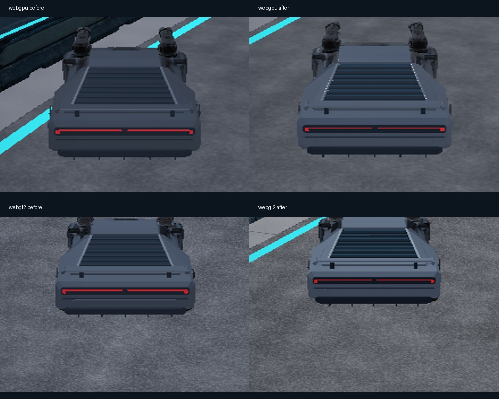

# Cybercar player vehicle

## Current model — wheel repair, 2026-10-22

Vektor uses `assets/runtime/models/cybercar-clean-detail/cybercar.glb` for the
player and matching AI rivals on both tracks. The ivory/graphite Tripo body,
weapons, shields, upgrades and controls remain in use. Original and detailed
67-part provider outputs are retained unchanged in `artifacts/model-jobs/`.

The first integration used a radial triangle mask to separate wheels from the
fused source. That preserved the assembled mesh but cut through tire/body
connections, producing torn edges in motion. Its triangle-preservation and spin
checks did not establish that the wheels were complete. That implementation and
its earlier visual acceptance are superseded by this repair.

The repaired runtime has **49,034 triangles in six meshes**: body, wheel-well
liners and four complete wheel assemblies. Each wheel contains closed round
tires with circumferential grooves, an alloy barrel, ten beveled spokes (five
per side), two hubs, ten lug heads and a rotor. All 25 component surfaces are
closed, consistently wound and centered on the axle. A shared 256 × 32 color/ORM
palette separates rubber from metal; wheels no longer use the distorted source
normal map. The body retains the three original 4K images byte-for-byte.

The preparation script removes the original wheels and clips four defined
openings into the body, interpolating body UVs/normals at the cut boundaries.
Recessed dark liners cover the interior. This intentionally replaces source
triangles; preserving all original faces would retain the original defect.
The model keeps its 4.3 scale, -0.65 m body offset, fitted axle centers and
0.35475/0.3569 m front/rear radii. The new tires are 0.258 m wide.

Vektor's suspension range is 0.24–0.38 m around the existing 0.30 m reference
length: 6 cm bump and 8 cm droop. The old generic 0.10–0.45 m range did not fit
this sports-car body. Steering remains ±0.42 radians (about ±24°) at the front.
The body collider and other vehicle tuning remain unchanged. `VehicleComponent`
continues to provide all interpolated wheel transforms, with no visual clamping
or independent rotation. Jolt's bump stop is a constraint and can briefly
compress beyond its nominal minimum; the clearance validator also covers 10 mm
of transient overtravel.

## Reproduction and evidence

```text
python scripts/prepare-clean-cybercar.py
python scripts/check-clean-cybercar.py
python scripts/cybercar-contract.py
python scripts/dev.py build
ctest --test-dir build/native -R "racing_wheel_travel|racing_smoke|racing_desert" --output-on-failure
```

The offline validator checks closed welded topology, consistent winding, axle
bounds, removal of old wheel geometry, and body/liner clearance. A conservative
cylinder encloses each wheel for every rotation angle. Steering is sampled at
0.01-radian intervals with an analytical error margin; suspension endpoint tests
bound all intermediate travel. Minimum clearance, including the 10 mm overtravel
allowance, is 10.5 mm front and 20.0 mm rear.

`racing_wheel_travel` drops the chassis while steering both ways and verifies all
four rendered wheel matrices against their physics poses at every step. Every
wheel reached full droop and bump, with measured minima 0.23349–0.23539 m and
maximum 0.38 m. The test passed in 8.43 s. `racing_smoke` and `racing_desert` also
passed (192.51 s and 132.47 s), including driving, recovery, reverse, combat and
complete simulated races. These are native simulation checks, not native rendered
acceptance.

`review-cybercar-wheels.py` produces 72 controlled renders of the actual runtime
GLB: both sides, three suspension positions, three steering positions and four
quarter-turn phases. Review grid/animation:
`artifacts/model-review/cybercar-clean-detail/wheel-motion/index.html`.

`cybercar-smoke.cjs` passes on WebGPU and WebGL2 with the new asset, checking hash,
failed-download retry, wheel spin, steering, pause, recovery and selection.
`cybercar-wheel-motion.cjs` records close views using actual keyboard controls and
physics in solo mode. The `wheelReview` URL parameter only changes the camera;
it never overrides wheel transforms. Runtime images, telemetry and animation
are under `build/evidence/cybercar-wheel-repair/`.

Both close-up renderer runs passed with no console/page errors. Their recovery
drops sampled roughly 0.293–0.38 m suspension lengths; the separate native drop
test covers full bump. Inspected both sides in the controlled full-travel renders
and live renderer sequences. Port 8117 serves the verified GLB and Wasm;
the served Wasm SHA-256 is
`2655fbc0cf1664c5389378cf72a316622efd992966ae335d8bbd69280aa859fc`.

Runtime SHA-256:
`274eb030c52d37b31ba56e63083e1631e6817b11e8690da056ed1e88d6198237`.
The manifest records both provider task IDs and source hashes. This repair makes
no paid provider calls. The selected WebEngine remains the clean pinned commit
`9b597da84d4582973d010fa9ba3e328c20181892`. WebGPU renders the PBR wheel material;
the pinned WebGL2 fallback has a simpler diffuse response. Body maps consume
192 MiB plus 64 KiB for the two wheel maps, before GPU copies/mipmaps. Physical
mobile performance remains unverified.

## Previous model and validation history — 2026-10-20/21

Before the replacement above, the player's Vektor used
`assets/runtime/models/cybercar1/cybercar1_rear_refined.glb`.
The browser fetches this exact file and verifies its SHA-256 before importing.
Enter Circuit stays disabled until all four chassis load; a failed download/import
offers Retry Car Download or Retry Vehicle Download. Matching AI racers share
the decoded Vektor art. Bastion, Skimmer and Vector are covered by
[vehicle integration](vehicle-integration.md). The player's cannon and shield
components remain attached.

## Model and wheel binding

The original `cybercar1_parts_textured.glb` is retained unchanged as the source.
The refined runtime model has 15 parts and 15,185 triangles. It rebuilds the rear
roof transition, shoulders, window, seven louvers, spoiler, fascia, running-light
lenses and diffuser. The front wedge, side doors and four original wheels retain
the car's identity. `StarterScene::installPlayerCar`
imports it once with mesh optimization disabled to retain primitive ordering,
then rebuilds the separate components from those ranges. Materials distinguish
satin gunmetal, brushed trim, graphite aero, smoked glass and emissive red lenses.
The retained shell uses a 2048 × 2048 albedo with compressed baked highlights;
the damaged normal map is omitted from bodywork. Wheels retain their original
three 4096 × 4096 maps and shared material. Two shared 1024 × 1024 rear atlases
carry baked panel seams, louver occlusion and metallic/roughness variation.
The six RGBA maps occupy 216 MiB
before GPU copies/mipmaps; physical-mobile memory/performance is unverified.

`src/cybercar_contract.hpp` records part names, index counts, wheel pivots,
radii and runtime hash. Rebuild offline, then regenerate the contract:

```text
python scripts/refine-cybercar.py
python scripts/check-cybercar-refinement.py
python scripts/cybercar-contract.py
```

The game applies a uniform scale of 4.3 (about 4.21 metres long) and maps source
`-X` forward to game `+Z` forward, retaining `+Y` up. Body geometry receives a
chassis-local vertical offset of -0.65 metres. Wheel geometry is centered around
the supplied fitted pivots before this coordinate conversion.

The independent components are `wheel_front_left`, `wheel_front_right`,
`wheel_rear_left` and `wheel_rear_right`. Their saved IDs bind directly to the
existing `VehicleComponent` in that order. Wheel radii, widths and suspension
mount positions come from the transformed model; mount height allows a 0.30 m
reference suspension length. The established body collider remains in use.

The engine's interpolated wheel poses supply suspension, steering and spin.
Only front wheels have nonzero maximum steer angle. No frame-rate-driven visual
rotation loop is added, and game input does not independently rotate the meshes.
Pause, teleport/recovery, vehicle switching and restart use the same physics
lifecycle as the other vehicles.

The rear preparation uses Pillow and headless Blender 3.5 and makes no provider calls. The original GLB,
its provenance and wheel streams remain intact. The preparation script is the
editable geometry source; the derived `.asset.json` records source/output hashes
and wheel fingerprints. `scripts/render-cybercar.py` supplies optional Blender
rear, quarter and side inspection renders. `scripts/cybercar-rear-camera.cjs`
captures the actual gameplay camera on both backends without camera overrides.
The red lenses are steady running lights, not a newly implemented brake signal.

## UV, bevel and material pass — 2026-10-21

The authored rear now has a packed UV atlas rather than constant `(0,0)` UVs.
`scripts/bake-cybercar-rear.py` bakes source-space shoulder/deck/fascia panel seams,
louver recess occlusion and restrained surface roughness variation into two
1024px maps. All five rear material families share those maps. Color is stored
as sRGB; the packed metallic/roughness map is linear data. No directional light
highlights are baked into the color map.

Manufactured edges use a two-segment bevel with a maximum world radius of 5.16mm,
clamped on thin panels. Open shoulder sheets receive a thin backing. Face-area
and corner-angle weighted split normals keep broad surfaces planar while their
bevels catch the existing lights. Degenerate bevel triangles are omitted and all
exported corner normals are normalized and checked against winding. The original
wheel geometry never passes through Blender or a GLB re-exporter.

| Material | Nominal roughness | Metallic |
| --- | ---: | ---: |
| Satin bodywork | 0.40 | 0.42 |
| Brushed trim | 0.27 | 0.85 |
| Matte louvers/aero | 0.86 | 0.05 |
| Opaque smoked glass | 0.12 | 0 |

The existing moonlight has a more oblique direction `(-0.65,-0.85,0.35)`, a less
saturated blue color `(0.72,0.82,1)` and intensity 1.65. Ambient fill is
`(0.34,0.39,0.52)` and environment intensity is 0.48. This increases separation
between lit edges and recesses without adding lights, shadows or reflection
captures. These are scene-wide light adjustments.

WebGPU uses the metallic/roughness and environment response. The pinned WebGL2
fallback uses diffuse lighting for ordinary meshes, so reflective glass and
metallic highlights are not equivalent there; its visible improvements come
from the baked colors/recesses, bevel geometry and weighted normals.



The captures use normal gameplay cameras; moving cars are not pixel-aligned.
Before/after studio and browser evidence is retained under
`artifacts/cybercar-material-pass/` and `build/evidence/cybercar-material-pass/`.
`rear-authoring.blend` retains the editable rear and procedural bake nodes.
Set `BLENDER_EXECUTABLE` to override the preparation script's Blender path.

Previous runtime SHA-256:
`c3c5c689f7e6375ee965a14479242385a5b9199cb4284954ead643b47145bc29`.
The wheel/UV/normal/map validator passes, and the car browser smoke checks pass
in both WebGPU and WebGL2, including the exact hash, corrupt-download retry,
rendered wheel rotation, front-only steering, pause, recovery and chassis switch.
All 10 native checks also pass, including asset import, driving and complete-race
coverage (`python scripts/dev.py native`, 246.94 seconds).
No paid generation or engine changes were needed.

## Earlier rear refinement validation — 2026-10-21

- `python scripts/check-cybercar-refinement.py`: exact equality of all four original
  wheel position/normal/UV/index streams, node pivots and radius metadata; matching
  source/output hashes; 952 authored rear triangles with consistent winding/normals.
- `python scripts/dev.py native`: all four registered game checks passed
  (`racing_smoke`, `racing_chassis_races`, `racing_street_kit`, `racing_track_kit`).
  Import checks cover the new material families and all 8,572 prepared triangles;
  existing native driving and complete-race checks also passed.
- Fresh `build/web/site` from clean selected engine
  `9b597da84d4582973d010fa9ba3e328c20181892`, Emscripten 6.0.11.
  Wasm SHA-256: `68eee0ab5f6f52517c271cfcce2764a2da8bc4b0f56f18e96a0df454cfef13af`.
- Runtime GLB SHA-256:
  `78314a5d084929bc8f15efe5877b179c645898abb9e00277dbcfa1377e14b09e`.
- `scripts/cybercar-smoke.cjs` passed serially on actual WebGPU and WebGL2:
  invalid-asset retry, runtime hash, all four wheel bindings and rendered rotation,
  front-only steering, pause, recovery, vehicle switching and narrow viewport.
  No recorded console/page errors. Reports: `build/evidence/cybercar-rear/smoke/`.
- Inspected rear/quarter/profile studio renders and the unchanged gameplay chase
  camera on both backends at 1440 × 900. Before/after captures live under
  `build/evidence/cybercar-rear/`; a station overhang can obscure early race frames,
  so final camera capture also includes an open stretch after 4.5 race seconds.

This is desktop Chromium and native evidence; physical mobile is unverified.
The original source asset and unrelated working-tree changes are preserved.

## Original integration validation — 2026-10-20

- Selected engine: `9b597da84d4582973d010fa9ba3e328c20181892`, clean submodule.
- Generated consumer site: `build/web/site`, Emscripten 6.0.11.
- Wasm SHA-256: `a23d55f2bb184cf00114726418c3ff24cc73c2321152191c96a5da801999b107`.
- Model SHA-256: `230d8278a968f9b2389018201efced83ddd07f7e447bcc05f23ad1db2b3d5331`.
- Native `racing_smoke`: passed in 35.88 s in isolated `build/native-cybercar`.
  Covers shared maps, triangle counts, four separate wheels, spin, steering,
  rendered wheel matrices/pivots, handling, lifecycle, barriers and complete
  three-lap races for both player classes and every AI rival.
- Handling measurements isolate racer-to-racer collision so an AI rear-end push
  cannot invalidate a braking assertion. Full-race tests retain normal collisions.
- `scripts/cybercar-smoke.cjs`: passed serially on WebGPU and WebGL2 in desktop
  Chromium 155.0.8059.85. Tests invalid asset/retry, verified model download, named
  wheel bindings, changing rendered wheel orientation, front-only steering,
  pause, recovery, car/hover switching and 390 × 844 layout. No console or GPU
  errors were recorded. Desktop screenshots use 1440 × 900.

Browser report and inspected screenshots are in `build/evidence/cybercar/`.
The browser checks exercise the start of a race and lifecycle controls;
complete-race acceptance above is native simulation evidence.

To repeat the browser check against a fresh served consumer build:

```powershell
# NODE_PATH must contain Playwright.
$env:DEMO_URL = 'http://127.0.0.1:8088'
node scripts/cybercar-smoke.cjs
```
