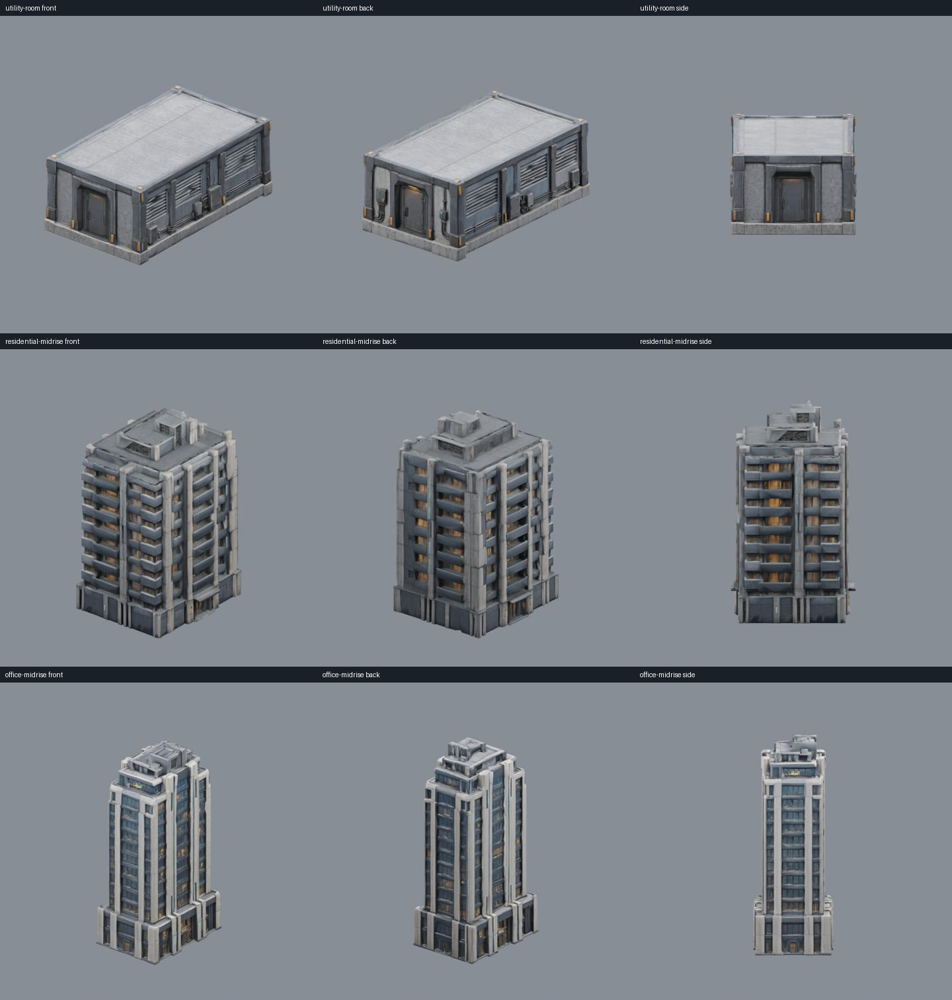
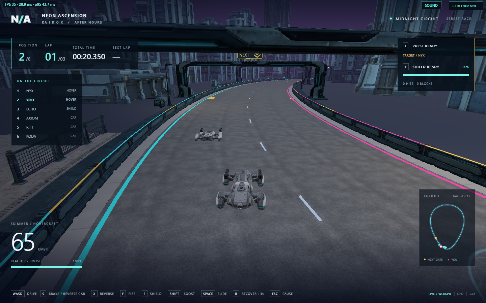

# Kairox utility room and complete skyline

Three buildings were created with built-in ImageGen references followed by Tripo
image-to-model on 2026-10-21. The utility room replaces the plain support box at
`(20, 0, 25)`, with a service door, wall vents, connection cabinets and conduits.
Its exact 6 x 4 x 10 metre envelope keeps the existing catwalk and rooftop equipment
at their authored heights.



[View the three models in the running game](images/skyline-expansion-in-game.jpg).

| New model | Instances | Full-detail triangles | Runtime file |
| --- | ---: | ---: | ---: |
| Service utility room | 1 | 16,539 | 4.11 MB |
| Residential mid-rise | 48 | 17,836 | 3.84 MB |
| Office mid-rise | 48 | 16,368 | 3.90 MB |

The stepped and crowned towers now have 26 and 25 instances respectively,
including their four original landmark placements. All 143 former skyline boxes
use these four existing building models. Alongside 21 authored city details, the
city kit has 14 resources and 164 instances. No additional assets or provider
calls were required. This replaces the remaining 131 boxes beyond the original
twelve-building expansion; procedural towers, window bands and rooftop rims are
no longer generated.

## Placement and rendering

`StarterScene::buildCity` preserves the deterministic skyline candidate grid and
orders it by distance to the circuit. Every eligible site receives a repeated
residential, office, stepped or crowned model, facing its front (+X) toward the
road. There is no count or distance cutoff. Uniform scale fits the complete
rotated footprint inside a 15m radius and half the gap to neighbouring sites,
with a 1m separation. Existing street, road and authored-building reservations
remain in force. Per-placement scale leaves the asset contracts unchanged.

All instances of a model share its immutable mesh, material and maps. All three
new models have one primitive, one PBR material and three 1024px embedded maps.
`static_art.hpp` retains full-detail surfaces and derives three shared automatic
LODs before publication. No new reflection captures, lights or driving obstacles
are added. The utility room takes the place of its old box rather than overlaying
it. The narrow catwalk support posts remain procedural.

## Reproduction and provenance

The [ImageGen prompts](skyline-expansion-prompts.json) are committed. Inspected
references and prompt/hash records are retained in
`artifacts/model-input-images/kairox-{utility-room,residential-midrise,office-midrise}/`.
Raw models and resumable task checkpoints are in the matching
`artifacts/model-jobs/` directories. Runtime GLBs and sanitized provenance records
are in `assets/runtime/models/city-kit/`.

Exactly three Tripo generation tasks completed, using **180 credits** total.
There were no paid retries or segmentation stages. The previously retained
UUID-compatible helper was used with an explicit `--face-limit 20000` and the
repository skill's detailed geometry/PBR defaults. All delivered meshes were
already under the triangle cap; no offline decimation was necessary. Utility-room
geometry was fitted to the existing assembly envelope; the other two resources
were normalized to 36m and 48m before placement scaling.

Rebuild from the retained sources without provider calls:

```powershell
& 'C:/Program Files/Blender Foundation/Blender 3.5/blender.exe' --background --python scripts/prepare-city-kit.py -- utility-room residential-midrise office-midrise
& 'C:/Program Files/Blender Foundation/Blender 3.5/blender.exe' --background --python scripts/inspect-city-kit.py -- kairox-utility-room kairox-residential-midrise kairox-office-midrise
python scripts/dev.py native
python scripts/dev.py build
```

The city review camera supports `?renderer=webgpu&cityReview=11` for the utility
assembly, `cityReview=12` for residential and `cityReview=13` for office. The same
views work with `renderer=webgl2`. Normal gameplay cameras are unchanged.
Add `&skylineTour=1` to expose the existing tour panel with all three additions,
the two reused tower models, and a return-to-racing link.

The later [WebGL2 shader fix](webgl2-performance-fix.md) improves performance
while retaining every real building and its existing shading.

## Complete-skyline validation (2026-10-23)

The native city-kit check verifies all 164 placements, exact per-model counts,
road/building/pairwise footprint clearance, absence of the old skyline actor,
shared meshes/maps and atomic installation. `city-kit-smoke.cjs` checks the same
counts and separation on both browser backends, alongside asset hashes, retry
gating, a valid driven lap, active LODs and render-pass counts. Current results
are recorded in `build/evidence/complete-skyline/`.

- The focused native placement check and full Windows smoke executable passed,
  including complete car/hover races, physics, lifecycle and asset readiness.
  Current Ninja objects/libraries were linked into a separate executable to avoid
  replacing outputs in use by concurrent tests; the selected engine was unchanged.
- Real Chrome WebGPU and WebGL2 both loaded 14 hashed models and 164 placements,
  rejected/retried a corrupt download, and drove a valid lap with zero recoveries
  and no console/page errors. LODs were active; render passes never exceeded three.
- First-lap averages were 35.9 FPS (WebGPU) and 14.7 FPS (WebGL2) while other local
  tests were running. WebGL2 remains slow; these samples are not an isolated
  before/after comparison or a 60 FPS acceptance result.
- The accepted Wasm SHA256 is
  `89f83aa0f8afbcfc627ea33c1a6d8afc827ea240e1d5cfcd34b9131572b4ba69`.



## Original near-skyline validation (2026-10-21)

Three-angle Blender renders were inspected for all three prepared models.
Runtime import checks validate triangle count, materials, bounds and origin;
the browser validates SHA256 before import. Native tests cover footprint clearance,
instance counts, shared geometry/maps, malformed imports and exact near LOD surfaces.
Renderer acceptance evidence is recorded in `build/evidence/skyline-expansion/`.

- All ten native tests passed, including city-kit sharing/clearance, all 48 static
  resources' LOD checks, the complete scene smoke test and chassis races.
- `city-kit-smoke.cjs` passed in Chrome on WebGPU and WebGL2: 14 hashes, 33
  placements, corrupt-download rejection/retry, and one valid driven lap per
  backend with zero recoveries and no console/page errors.
- During those laps, LOD selection was active and render passes never exceeded
  three; puddle planar captures remain disabled. The logged FPS samples are
  first-lap smoke measurements taken alongside other local work, not an isolated
  before/after performance comparison.
- The final camera/tour follow-up uses `skyline-tour-smoke.cjs` to exercise all
  five selectable views and return to racing in both backends. Screenshot review
  is required in addition to the script: it caught a neighbouring building
  obscuring the first residential camera, which was moved to the road-facing side.
  The corrected tour passed on both backends, and its new-model screenshots were
  inspected with the full silhouettes visible.

The exact selected engine was the clean pinned
`9b597da84d4582973d010fa9ba3e328c20181892`, built with Emscripten 6.0.11.
