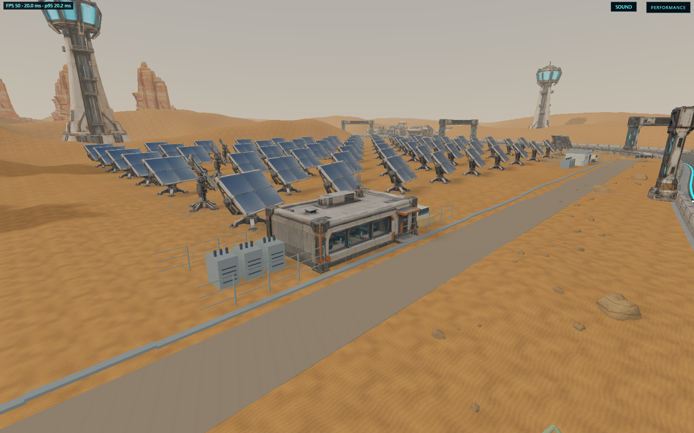

# Solar operations house and desert surfaces

The eastern solar service compound at (40, -131) now uses a Tripo operations
house instead of the plain block shelter. The observation facade faces the
track. Existing transformer cabinets, fence, access lane and parked truck remain
in the compound; the cabinets are offset to clear the larger building.

The building is 11 x 5.304 x 7.478 m including its antenna, 16,571 triangles,
one PBR material and embedded maps capped at 2048 px. Runtime size is 3,363,956
bytes. Geometry is uniformly scaled with a bottom-centered pivot and a static
footprint collider outside the driving envelope.

- ImageGen reference and exact prompt: `artifacts/model-input-images/solar-operations/`.
- Tripo task: `4b04b3db-fab2-445b-8e97-b9da45b3482d`, 60 credits consumed.
- Raw model/job/provenance: `artifacts/model-jobs/solar-operations/`.
- Preparation and front/back QA: `scripts/prepare-solar-operations.py` and the job's `qa/` folder.
- Runtime model, hash and sanitized provenance: `assets/runtime/models/desert-solar/solar-operations/`.

The ImageGen reference was inspected before submission; the delivered model was
inspected in offline renders and the actual game. Asset routing now uses names
for the desert kit folders, and C++ queue offsets use model counts so adding the
house does not shift village or gantry downloads into the wrong folder.

Sand previously used only a faint colour texture, and grading flattened the
whole solar field. `desert_surface.hpp` provides seamless grain, wind ripples,
mineral variation, normal detail and roughness maps. Shallow physical drifts
occupy gaps outside equipment pads, service lanes, village foundations and road
clearance. The existing larger dunes remain intact.

Nearby stones now have layered sandstone textures, grain normals and varied
tones. Their normals are recomputed after shape deformation. Imported cliff and
arch materials preserve their maps with stronger normal relief and a dry,
non-metallic finish. Service roads have separate material batches. WebGL2 uses
the albedo/geometry detail; the PBR path also resolves the normal and roughness
maps supported by its backend.

Validation: `racing_dune_villages` covers the new house import, placement,
collision, relief maps and village clearance; `racing_desert_race_kit` covers
gantry clearance. `scripts/solar-operations-smoke.cjs` verifies all twenty desert
assets, the runtime house hash, operations/sand/canyon views and normal driving
and pause in both forced renderers. Reports and screenshots are under
`build/evidence/solar-operations/`. The review camera is available with
`?track=desert&operationsReview=1`.

On 2026-10-23 both forced browser backends passed asset hash/readiness, detail
views, driving and pause checks with zero page/console errors. The final tested
Wasm hash is recorded per backend in `build/evidence/solar-operations/report.json`.
Both focused native tests passed after the final terrain adjustment.
The full native desert scenario also passed: all four chassis completed three
laps with zero recoveries, with the road and arch driving envelope verified.
It used the same compiled smoke-test objects linked as
`build/native/solar_desert_validation.exe` to avoid relinking another task's
running `racing_smoke.exe`.
