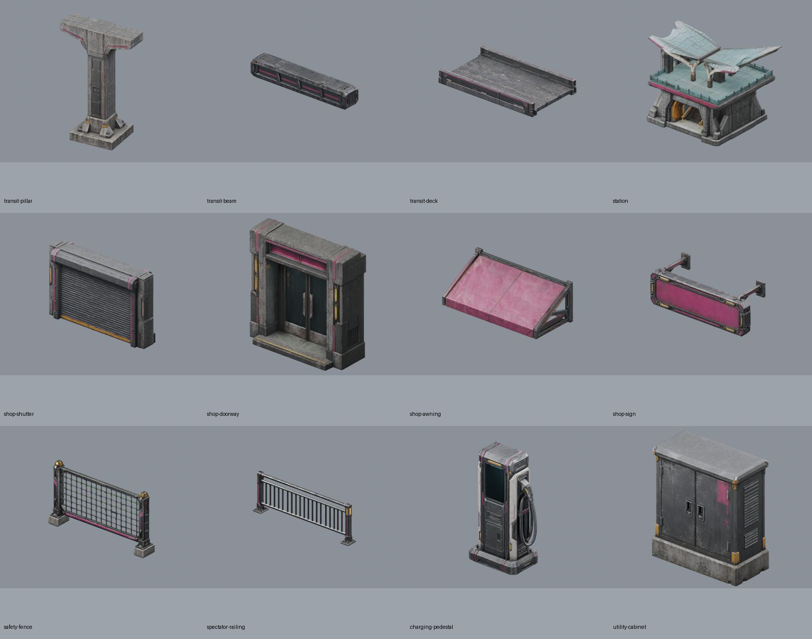
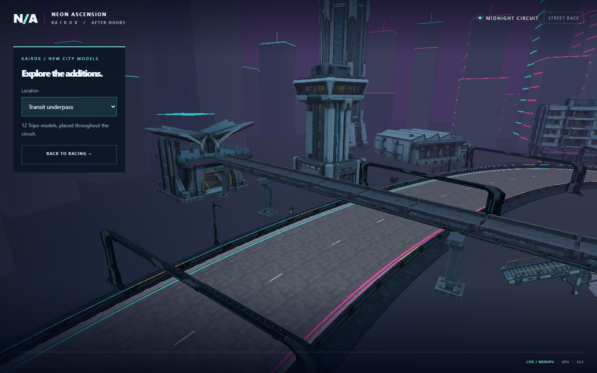

# Kairox transit and street modules

Twelve ImageGen-to-Tripo models form 77 placed modules in the Kairox circuit.
The floating sky slab is replaced by a supported station underpass. Shopfronts
attach to the market apartment walls, fences close side-street mouths, railings
separate spectator space, and chargers/cabinets dress the service depots.

## Runtime placement

- Transit: four 8 m pillars, three bearing beams, nine adjoining deck sections
  and one butterfly-canopy station at circuit sample 56. The lowest overhead
  collision begins at 8 m. Pillars sit outside the continuous crash barriers.
- Shops: shutters and doorways form 3.4 m facade bays on the three market
  apartment blocks, with two awnings and three blank sign frames per building.
  The mounting plane accounts for the source building's projecting canopies.
- Safety: twelve tall fence panels at four side-street mouths and fifteen
  railing panels beside three spectator areas, behind the racing barriers.
- Service frontage: two chargers and one utility cabinet at each of three depots.

`src/street_kit.cpp` owns placement and simple collision. Instances share the
same immutable mesh and embedded maps. Full-bounds collision is intentionally
conservative; station interiors are scenic and not a walkable passenger route.
Overhead signs and awnings have no additional collision. Skyline generation
reserves space for the new structures.

The browser imports models sequentially through the existing scene queue.
Every download must match its SHA256 contract, and import bounds/triangle counts
are checked before actors are published. Race entry waits for every scene asset.
A failed download retains earlier imports and exposes the existing retry action.

## Assets and reproducibility

Prepared assets and sanitized provenance are under
`assets/runtime/models/street-kit/kairox-<name>/`. The 12 GLBs total 37.75 MB and
495,265 unique triangles. Large transit/station models use 1024 px embedded maps;
the remaining props use 512 px maps. Original full-detail geometry and UVs are
retained. Before publication, `static_art.hpp` applies lossless vertex/index
optimization and generates three shared, error-bounded distance LODs through
the selected engine. All instances/levels share the original maps. See
[performance diagnosis and acceptance](performance-diagnosis.md).

| Module | Triangles | Prepared MB |
| --- | ---: | ---: |
| Transit pillar | 44,999 | 4.75 |
| Transit beam | 42,848 | 5.05 |
| Transit deck | 40,038 | 4.94 |
| Station | 42,443 | 4.89 |
| Shop shutter | 37,522 | 2.31 |
| Shop doorway | 37,252 | 2.02 |
| Shop awning | 42,913 | 2.10 |
| Shop sign frame | 39,457 | 2.29 |
| Safety fence | 43,427 | 2.47 |
| Spectator railing | 43,026 | 2.37 |
| Charging pedestal | 43,731 | 2.33 |
| Utility cabinet | 37,609 | 2.24 |

[Exact ImageGen prompts](street-kit-prompts.json) are retained with the design
sources. Saved reference PNGs, prompt files and SHA256 records are in ignored
`artifacts/model-input-images/kairox-<name>/`. Raw models, task IDs, charges and
four-view renders remain in `artifacts/model-jobs/kairox-<name>/`; the pillar's
successful task is in `kairox-transit-pillar-v1/` because its initial reference
upload failed before generation submission.

Exactly twelve paid generations completed on 2026-10-21, 60 credits each,
**720 credits total**, within the user's approved cap. No replacement generation
or segmentation was submitted. Generation used the skill defaults, including
detailed v3.1 geometry, a 50k triangle target and detailed v3.5 PBR textures.
The retained UUID-compatible helper from the earlier vehicle/building work was
used. Account entitlement remains unverified in the provenance records.

`scripts/prepare-street-kit.py` reproduces metric normalization, map resizing
and four-view Blender QA from the raw jobs. It exports +Y-up GLBs with a
bottom-centred origin, facade front +Z and structural length +X. Run
`python scripts/street-kit-contract.py` after preparation to regenerate the
verified hash/bounds contract.

## Validation

All twelve prepared models were inspected from front, rear, side and top in
Blender; the transit and storefront assemblies were also rendered together.
The dedicated `racing_street_kit` native test passes all 12 imports, 77 placements,
shared resources, failed/duplicate import handling, full-footprint road clearance
and an actual physics ray through the underpass. Full native gameplay regression
and Bastion/Vector complete races also passed using an alternate executable name
because the usual smoke-test binary was locked by another concurrent task.

WebGPU and forced WebGL2 both passed `scripts/street-kit-smoke.cjs` on
2026-10-21 using the generated pinned-engine site. Each imported all twelve
matching asset hashes, rejected a deliberately corrupted cabinet download,
kept race entry blocked until retry succeeded, and completed a physical lap
through the underpass with zero recoveries and no console errors. Recorded lap
times were 35.167 s (WebGPU) and 35.033 s (WebGL2). These are functional driving
checks, not rendering-performance benchmarks or physical-mobile acceptance.

Evidence is under `build/evidence/street-kit/`, including `results.json`,
gameplay screenshots, and six location views for each backend. The checked Wasm
SHA256 was `68eee0ab5f6f52517c271cfcce2764a2da8bc4b0f56f18e96a0df454cfef13af`;
the test confirmed it remained unchanged throughout both renderer runs.

Open `?renderer=webgpu&streetReview=0` (or `renderer=webgl2`) for an in-world
tour. Its location selector switches among the underpass, station, shopfronts,
safety fence, spectator railing and depot frontage. Back to Racing restores the
ordinary game. `scripts/street-kit-tour-smoke.cjs` passed all six views, narrow
viewport layout, and return-to-racing on both backends. The tour changes only
the camera and overlay; it shows the same placed actors used during races.

