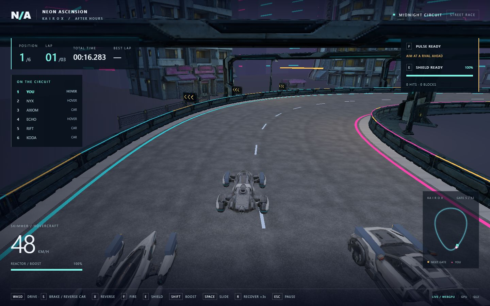

# Tripo racing corridor kit

Implemented 2026-10-21 using thirteen built-in ImageGen references followed by
thirteen Tripo image-to-model jobs. Every requested model is used in the playable
Kairox circuit. No additional generation or segmentation tasks were needed.

## Runtime layout

| Model | Instances | Use |
| --- | ---: | --- |
| Straight crash barrier | 192 | Both continuous track edges; original collision retained |
| Corner barrier | 4 | Service lay-by corners behind the race barriers |
| Barrier end cap | 4 | Service lay-by terminations |
| Finish gantry | 1 | Start/finish, alongside the existing checker stripe |
| Checkpoint gantry | 11 | Remaining sector gates |
| Streetlight | 16 | Alternating sides of the corridor |
| Wall lamp | 24 | Paired building entrance lamps |
| Chevron board | 6 | Directional warnings at the two major bends |
| Braking marker | 4 | 50 and 100 metres before those bends, measured along the centreline |
| Pavement module | 192 | Continuous sidewalks outside both barriers |
| Curb module | 192 | Sidewalk edges |
| Corner paving | 24 | Building entrance approaches |
| Storm drain | 24 | Inset sidewalk drainage |

Total: **694 instances** sharing thirteen meshes and their textures. Gantries are
35 metres wide including their broad feet; their lower geometry stays beyond
11.8 metres either side of the centreline. Ground props stay outside the racing
envelope. Decorative meshes do not replace or complicate the existing 192
continuous barrier colliders.

The shared models now pass through `static_art.hpp` once before publication:
lossless cache optimization retains close-view faces, and three error-bounded
distance LODs reduce distant track furniture. Levels share the source maps.

Six nearby point lights follow the closest installed lamp locations, leaving
room for the moonlight within the selected engine's eight-light limit. Exact
chevrons and luminous braking numerals are authored in game code. Light strips
are narrow enough to leave the new barrier surfaces visible.

## Assets and reproducibility

- Source references, prompts and hashes: `artifacts/model-input-images/kairox-*/`.
- Retained paid jobs and original GLBs: `artifacts/model-jobs/kairox-*/`.
- Runtime GLBs and sanitized task IDs, hashes and metrics:
  `assets/runtime/models/track-kit/<asset>/<asset>.asset.json`.
- Reference prompts and preparation targets: `docs/track-kit-spec.json`.
- Offline preparation: `scripts/prepare-track-kit.py`, executed in Blender 3.5.
- Runtime contract generator: `python scripts/track-kit-contract.py`.
- Three-view studio review: `scripts/inspect-track-kit.py`, executed in Blender.

Generation retained the skill defaults: detailed v3.1 geometry, requested 50,000
faces, detailed v3.5 textures, PBR, triangles, image autofix off and delight off.
Actual originals contain **545,836 triangles** in total. Runtime versions contain
**28,692 triangles**, with freshly unwrapped UVs and base-colour, ORM and normal
maps baked from the originals. Gantries use 1024px maps; other modules use 512px.
The thirteen runtime GLBs total **11,749,496 bytes**. This is an asset reduction,
not a claim about performance on untested hardware.

Provider originals remain intact. Runtime preparation welds and simplifies
geometry, rebakes maps, normalizes the base-centred coordinate system, and fits
the prescribed dimensions. Contracts use exported triangle counts, since glTF
export can discard degenerate source triangles. Account entitlement remains
unverified in the provenance; release-rights evidence is still required.

`src/track_kit.cpp` owns placement, sharing, markers and lighting.
`src/track_art_contract.hpp` pins hashes, dimensions and counts. The existing
browser download queue loads all thirteen assets before enabling race start;
failed downloads retain completed assets and expose **RETRY TRACK DOWNLOAD**.
`?trackReview=0` through `12` provide explicit authoring views only.

## Validation

- All four native suites passed: focused track kit (0.42s), street kit (0.64s),
  full racing smoke (127.33s), and chassis races (40.87s).
- The final sign-contrast and light-strip polish also passed a fresh focused
  native track-kit run, including all 694 placements and shared meshes.
- Full browser validation: `scripts/track-kit-smoke.cjs`, real Chrome, forced
  WebGPU then forced WebGL2 serially. All thirteen assets visually inspected,
  hashes checked, failed final download/retry exercised, and race-start gating
  verified. Each backend completed a valid full lap with zero recoveries and
  zero browser errors; pause froze the clock.
- Final evidence: `build/evidence/track-kit/report.json` and JPEG views/lap captures.
- Tested frozen Wasm SHA256:
  `5f989ec07232f006ce05e5d700906caeec69667a2cf535cb0ce697c7317a7147`.
  This matched `build/web/site/racing.wasm` after validation.

The full native smoke timeout is now 300 seconds because loading and exercising
the expanded scene exceeds the former 120-second allowance. A preliminary
browser run was interrupted by disk exhaustion; only this task's duplicate build
and preliminary screenshots were removed. Final validation uses shared asset
files and compact JPEG evidence and completed successfully. No physical-device
or production performance acceptance is implied by these desktop browser checks.
