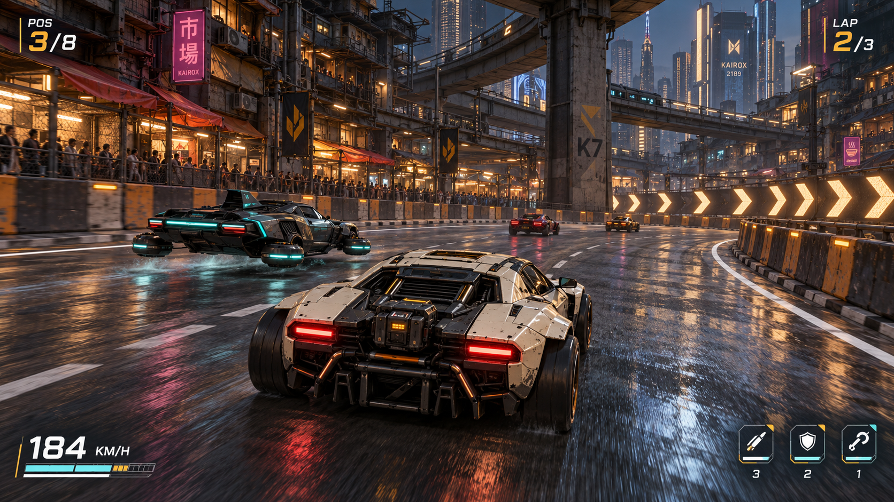

# Neon Ascension — visual and world design

Status: proposed art direction, 2026-10-20.

This document defines the look of RacingGame: style, color modes, vehicles,
3D assets, circuits, cities and interface. It expands the
[game design](game-design.md); the [architecture](architecture.md) describes
implementation. Dimensions and production budgets below are starting targets
to validate in the driving prototype.

## Visual promise

The player should feel the weight of a repaired street machine competing
against expensive corporate technology. The city is inhabited, maintained and
unequal: warm shops beneath aging infrastructure, improvised neighborhood
repairs, and clean towers above. Racing turns familiar public routes into
temporary arenas.

Use grounded, stylized realism: plausible materials and mechanical construction,
bold silhouettes, deliberately simplified small detail and readable lighting.
Prioritize road shape, opponents and combat cues at driving speed. Detail should
reward a garage close-up without becoming noise during a race.

Three visual principles:

- **Readable speed:** a clear road corridor, useful braking references and strong
  vehicle separation; speed comes from perspective, scenery rhythm and audio.
- **Repairable machines:** panels, fasteners, cooling paths and hardpoints explain
  how vehicles work and how upgrades fit.
- **A city with layers:** street life, public infrastructure and corporate power
  have distinct materials, scale and maintenance.

Avoid a continuous neon wash, featureless black roads, holograms covering the
driving line, excessive bloom and decoration that resembles a weapon warning.
Civilian crowds remain behind barriers; decorative traffic uses separate lanes.

## Reference image

**Figure 1 — Kairox, market bend.** Generated concept reference using built-in
ImageGen. This establishes the chase-camera composition, grounded vehicle
materials, low hover height, layered city and restrained amber/magenta/teal
palette. It is not a screenshot of the current game or proof of renderer
performance.

Carry forward the broad readable bend, distinct vehicle silhouettes, separated
spectators and warm street/cool skyline relationship. The production version
should simplify background detail and reflections, reduce oversized chevron
brightness and surface streaking, and preserve a clear braking view. The sample
HUD is illustrative: the actual HUD needs separate hull/battery/heat indicators,
forward/rear/defense labels and all states specified below.

The exact generation prompt and provenance are stored in
[the reference record](images/neon-ascension-kairox-reference.md).

## Color system

Use a common neutral foundation across every city. Treat these hex values as
sRGB art/UI tokens; lighting and material exposure are tuned in-engine.

| Token | Color | Role |
| --- | --- | --- |
| Graphite | `#111820` | Garage surfaces, dark body components, UI backdrop |
| Slate | `#293744` | Secondary panels, infrastructure and borders |
| Mist | `#AAB9C4` | Secondary text, cool surfaces, distance |
| Ivory | `#E8E6DC` | Primary text, pale bodywork and road references |
| Amber | `#F6B85A` | Selection, focus and warm neighborhood identity |
| Teal | `#66C9C8` | Battery/shield information and limited tech accents |
| Magenta | `#BC4B89` | Sparse environmental signage and customization |
| Hazard red | `#EF665D` | Damage/urgent threat, always with shape and text |

Aim for roughly 70% neutral structure, 20% city material/palette identity and
10% luminous or saturated accents in a typical frame. This is composition
guidance, not a texture quota. Emissive areas remain small enough for brake
lights, threats and route markings to be identifiable.

Keep world art palettes separate from semantic UI colors. A magenta city sign
does not imply a threat; a teal opponent paint job does not imply an ally.
Use icons, outlines, placement and timing to reinforce meaning.

### Color and presentation modes

| Mode | Intended use | Treatment |
| --- | --- | --- |
| Night / Neon | Default Kairox reference | Warm shops, cool ambient fill, sparse magenta signage, broken wet reflections |
| Overcast / Rain | Vanta and selected authored events | Cool gray daylight, amber machinery, restrained reflections, visible road edges |
| Day / Clear | Garage practice and authored daytime events | Pale sky, balanced exposure, material color carries identity; no dependence on neon |
| High readability | Player accessibility option for every setting | More opaque HUD backing, stronger route borders, reduced decorative glare and particle density |
| Alternative warning palettes | Player option with live preview | Replace semantic accents while retaining icons, labels and distinct luminance; test with players |

Night/day/rain are authored event conditions, not a required dynamic weather
system. High readability and warning palettes are independent settings.
Reduced flashing removes rapid pulses; reduced motion limits camera shake,
speed effects and blur. These options never remove lock direction, checkpoint
information or hazard timing.

The garage defaults to graphite surfaces and warm ivory text. Offer a light
garage/UI theme with ivory panels, graphite text and dark amber/teal accents
where contrast requires them. Do not recolor the physical world when switching
UI theme. Test actual text/background pairs at final opacity and scale.

## Vehicle design language

Vehicles must be recognizable from the rear at normal racing distance. Give each
chassis a primary mass, a distinctive rear-light arrangement and one defining
mechanical feature. Keep a shared scale and hardpoint language so equipment can
move between compatible builds.

| Feature | Wheeled cars | Hovercraft |
| --- | --- | --- |
| Silhouette | Low coupe, broad tire stance, grounded rear mass | Central hull with separated lift pods and stabilizers |
| Motion read | Wheel rotation, suspension compression, body roll | Pod response, modest banking, visible lateral glide |
| Mechanical story | Exposed drive/cooling parts, reinforced wheel arches | Lift ducts, cooling rails and directional thrusters |
| Road relationship | Four clear contact patches | Low hover gap, support shadow and restrained ground wash |
| Damage read | Scraped panels, damaged trim, small sparks | Scorched pod covers, unstable accent lights, damaged fins |

Initial size envelopes are approximately 4.2–5.2 m long and 1.8–2.2 m wide for
cars, and 4.4–5.4 m long and 2.0–2.4 m wide for hovercraft. Aim for comparable
racing footprints. Hover ride height starts around 0.35–0.65 m; do not frame the
craft as an aircraft. Verify collision envelopes on every shared route.

### Initial four chassis

These are working art names, separate from stable content IDs.

| Chassis | Class and role | Shape/material signature |
| --- | --- | --- |
| Patchwork | Starter balanced car | Squared coupe, replaceable ivory panels, exposed dark rear drive, paired rectangular brake lights |
| Skimmer | Starter agile hovercraft | Narrow central hull, four readable lift pods, graphite/teal trim, split rear light |
| Bastion | Heavy car | Broad shoulders, inset wheels, layered armor and larger cooling outlets |
| Vector | Fast hovercraft | Long tapered hull, lean outriggers, pale corporate panels and precise light strips |

The first two carry the driving prototype and career slice. Add Bastion and
Vector for the initial four-chassis release. Expansion grows to five cars and
five hovercraft using distinct proportions rather than minor cosmetic copies.

All chassis need a visible forward weapon mount, rear/utility mount and defense
emitter location. Keep weapons compact and mechanically attached. Heavy
equipment adds believable bulk, but does not cover brake lights, wheel travel
or the camera's road view. Upgrades change selected components and material
details while preserving chassis identity.

Cosmetic channels: primary paint, secondary panel, trim, decal, underglow and
boost trail. Reserve danger colors/shapes in the HUD even when a vehicle uses
the same paint hue. Starter vehicles must look cared for and capable; wear
communicates history, not poor visibility.

## 3D model production rules

Use meters, +Y up and +Z forward at the engine boundary. Verify export-axis
conversion, applied scale and pivots on every GLB. A car root uses a documented
chassis origin; wheel pivots sit at axle centers and hover pods have stable
attachment transforms. Use consistent names for hardpoints and visual children.

Build broad forms first, then secondary paneling, then surface detail. Spend
geometry on silhouettes, wheel arches, lift pods and parts visible in the chase
camera. Put fine seams, vents and wear in textures where possible. Model hidden
interiors only when a camera or animation can reveal them.

| Asset | Initial authoring target | Notes |
| --- | --- | --- |
| Hero chassis, LOD0 | 35k–60k triangles | Includes normal race-visible body detail; equipment budget tracked separately |
| Chassis LOD1 / LOD2 | About 50% / 20% of LOD0 | Preserve class silhouette, lamps and mount positions |
| Equipment module | 2k–6k triangles | Share materials and avoid many transparent layers |
| Repeating street module | 1k–8k triangles | Depends on screen coverage; reuse trim sheets and instances |
| Hero landmark | Explicit per-landmark budget | Approve after track profiling, not as an unlimited exception |
| Vehicle texture set | Usually 2K at highest quality | Shared trim/decals; lower tiers use reduced resolution |
| Repeating prop textures | Usually 512–1K or atlas | Consolidate related materials |

These are production planning limits, not measured WebEngine capacity. Eight
racers, track geometry, shadows, materials and effects must be profiled together.
LOD count and quality settings can change after that evidence.

Use base color, normal and metallic/roughness maps with deliberate material
separation. Painted metal has a broader roughness range than bare trim. Rubber
stays dark but readable; glass uses restrained tint. Avoid mirror-like asphalt
across the entire track: vary roughness and wetness with puddle masks.

Collision is authored separately: simple compound chassis shapes, solid barriers
and economical road collision. Visual antennas, fins and loose cables should
not catch the vehicle. Damage uses material states and a bounded set of visual
variants; city destruction is outside initial scope.

Before accepting an asset, inspect front/side/rear/three-quarter views, scale,
silhouette at race distance, pivots, normals, UV seams, materials, hardpoints,
collision and LOD transitions. Check it in both renderers. Follow
[asset production conventions](assets.md) for reviewed runtime files and
sanitized provenance. Concept images are references, not automatic 3D acceptance.

## Circuit design

Design from driving rhythm before decorating. A track should alternate pressure
and release: an easy-to-read acceleration zone, a braking decision, a technical
sequence, then space for recovery and overtaking.

Each route needs:

- Two reliable overtaking zones with enough width and useful exit sightlines.
- One technical section that rewards braking and line choice.
- One physical cover opportunity that breaks weapon lock.
- One signposted optional route, usable by both vehicle classes.
- Safe recovery anchors before major decisions and after difficult sections.

Starting dimensions: 12–16 m for broad straights, 8–10 m for ordinary corners,
and brief 6–7 m technical sections. Tight sections must have advance visibility
and a wider escape/exit. Final widths follow handling and eight-racer tests.
Vertical clearance includes the full hover jump and recovery envelopes.

Target initial circuit laps around 80–120 seconds for three-lap races of four
to six minutes. Determine length from measured average speed:
`length = average speed × target lap time`. Do not enlarge a track solely to
meet an arbitrary kilometer target.

Use a hierarchy of cues: continuous road edge, large turn chevrons, distinct
braking reference, then small local detail. At an assumed 180 km/h, a two-second
decision window requires about 100 m of visibility; tune sightlines to actual
vehicle speeds. Avoid forcing players to read small signs while steering.

### Kairox's three initial layouts

| Layout | Route and rhythm | Shared landmark | Distinct challenge |
| --- | --- | --- | --- |
| Market Loop | Plaza start → market bend → service chicane → station underpass → broad return | Elevated station and shop arcade | Precise braking and a contested plaza exit |
| Transit Run | Depot start → rail corridor → sweeping ramp → pillar section → tunnel return | Station viewed from another level | Sustained speed and line-of-sight management |
| Canal Service | Charging-yard start → maintenance lane → canal bridge → loading plaza → lower-market return | Charging station and market edge | Surface changes, drafting and wider contact zones |

These are genuinely different connected layouts, not reverse versions counted
as new circuits. Reuse landmark assets while changing corner sequences,
approaches and exposure. Initial release is circuit/time trial; sprint routes
arrive when that mode is implemented.

For Market Loop, greybox two overtakes at the start plaza and broad return.
Place missile cover at underpass pillars outside the racing envelope. The
optional service lane saves distance but imposes a slower entry and narrower
exit; it rejoins with clear visibility and no blind cross-traffic.

Road branches rejoin between shared progression gates. A jump cannot skip a
required checkpoint or land on an unrelated level. Avoid decorative intersections
that look drivable. Use barriers and road treatment, not invisible walls alone,
to explain the legal route.

Hazards are authored and repeatable: machinery has visible warning lights,
an audible cue and a clear active interval. Introduce hazards after clean
driving is established. Rain and traffic cannot randomly hide a braking cue.

## City design

Build cities as convincing race corridors with background depth. The initial
game does not require every visible street or building to be explorable.
Separate foreground collision/play space, midground activity and distant skyline.
Use foreground buildings to reveal and conceal vistas at planned driving moments.

| City | Architecture and social story | Palette/materials | Route language and landmark kit |
| --- | --- | --- | --- |
| Kairox | Dense apartments above improvised markets and transit | Graphite concrete, warm amber interiors, faded magenta signs | Station supports, shop arcades, charging yards, tunnels and market plazas |
| Vanta Port | Working harbor below flood defenses | Cold blue-gray rain, oxidized steel, amber machinery | Container stacks, cranes, pump houses, canal bridges and dock straights |
| Helix Heights | Corporate elevated transport and controlled access | Pale ceramic/composite, glass, restrained cyan | Skyway decks, structural ribs, glazed tunnels and sweeping ramps |
| Cinder Ward | Heavy industry mixed with repaired worker districts | Rust, dark steel, soot, furnace orange | Cooling plants, service yards, refinery silhouettes and rough lanes |
| Aurora Crown | Wealth above buried older infrastructure | Ivory stone, gold-white lighting, dark understructure | Civic plazas, tall arcades, boulevard starts and deep tower descents |

Each city needs a skyline silhouette, a repeating structural motif, a street-level
material family and a signature soundscape. Distinguish cities in grayscale and
by layout as well as by hue.

Kairox production starts with one finished corridor kit: road/curb/barrier
modules, shop bays and shutters, apartment facades, station pillars/beams,
stairs/catwalks, cables, a charging station and a small sign family. A practical
authoring grid starts at 2 m for small modules, 4 m facade bays and 8 m larger
structural spans; permit bespoke landmarks where the circuit needs them.

Use repeated structural modules with varied materials and limited dressing.
Place detailed props where the player slows down. Keep awnings, cables and
shop clutter outside collision and sightline envelopes. Crowds can be grouped
background assets; their animation budget should not compete with driving.

The initial release contains Kairox's three layouts and two local leagues.
Vanta, Helix, Cinder and Aurora are expansion art directions; the full target is
three core routes per city. Do not build five detailed cities before validating
one finished track.

## Interface, camera and effects

Use compact, solid-backed HUD groups with restrained angular corners and a
clear sans-serif typeface. Prefer tabular numerals for speed, position and
timers. Final font selection requires readable glyphs and a suitable license.

| Region | Information | Behavior |
| --- | --- | --- |
| Upper left | Position and race status | Stable footprint; explain elimination state when used |
| Upper right | Lap and time | Clear mode-specific labels |
| Near driving corridor | Next turn/checkpoint and incoming threat direction | Short-lived, shape-coded, never covering the apex |
| Lower left | Speed, hull, battery and heat | Distinct labels/icons; warning before depletion or overheat |
| Lower right | Forward, rear/utility and defense actions | Binding, ammo/charges, cooldown and unavailable reason |

Garage screens use the same graphite/ivory system, with the vehicle preview
beside a focused equipment panel. Keep the buy/apply/enter action fixed while
lists scroll. Show before/after statistics, physical tradeoffs and the exact
illegal slot. Test drive and undo/preset restoration remain easy to find.

Use the chase view as the primary composition test: vehicle occupies roughly
the lower quarter to third, horizon leaves enough road preview, and camera
distance/FOV are adjustable. Start around 60–75 degrees vertical FOV and tune
for desktop aspect ratios and comfort. Allow shake and speed effects to reach
zero. Recovery cuts camera history instead of dragging it through geometry.

Combat effects follow consistent shape language: pulse is a short sharp streak;
seeker has a clear acquisition reticle and directional warning; EMP is a compact
electric ring; a mine is a visible low hazard; shield is a brief readable shell.
Disruptor cloud stays localized and translucent enough to preserve road cues.
Every effect has a bounded lifetime and density.

Brake lights remain visible through body damage and trails. Boost trails are
short enough to avoid covering following racers' view. Damage sparks communicate
impact briefly; persistent fire or opaque smoke must not hide the route.

Engine/hover pitch, tire slip, lock warning, defense activation and radio each
need a distinct frequency/rhythm role. Threat warnings take priority over music
and decorative ambience. Subtitles and optional haptics reinforce essential cues.

## Production sequence and review

| Step | Output | Review gate |
| --- | --- | --- |
| Greybox | Market Loop, primitive car/hovercraft, route markings | Both classes can read, finish and recover on the same track |
| Vehicle language | Patchwork and Skimmer with mounts/materials | Rear silhouettes, wheel/pod motion and damage remain readable |
| One finished sector | Market bend, station supports and shops | Reference mood survives normal and high-readability settings |
| Complete Kairox track | Full lap, cover, alternate route, HUD and combat FX | Eight-racer play, no blind merges, both renderers and scaled text |
| Initial content set | Three layouts, four chassis, garage and local championship | Variety, reusable assets, stable performance and complete career presentation |

Capture the same driving locations on WebGPU and WebGL2 in daylight, night,
reduced-effects and high-readability configurations as applicable. Inspect
road/vehicle separation in grayscale, threat comprehension without sound,
controller navigation, text scaling and the most crowded combat scene.

Measure frame time, draw/material counts, memory, load time and effect peaks on
agreed desktop hardware. Reduce background cost before removing useful road or
threat cues. A beautiful still image is only one reference; final acceptance
depends on readable motion and usable controls.
