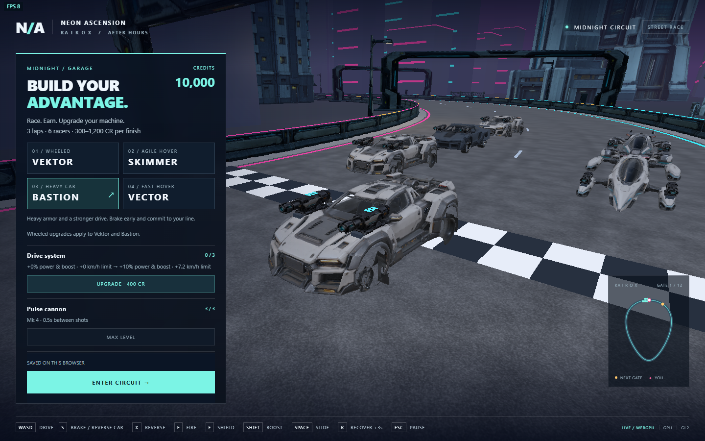

# Tripo pulse cannon upgrade

The four playable chassis and all AI rivals now carry a textured, imported pulse
cannon assembly in place of the primitive guns. One shared model is mounted twice
per vehicle, with chassis-specific hood/pod fittings and compact mounting shoes.
The existing cannon purchases appear as Mk 1–4 in the garage and add one luminous
rank indicator per purchased level to each module. Indicators move with recoil.

The simulation retains its existing 0.8 / 0.7 / 0.6 / 0.5-second firing intervals,
range, aim assistance, cover, disruption and shield rules. A shot alternates the
visible firing aperture, produces a short muzzle flash and recoil, and connects
the [laser pulse](laser-beam.md) to that aperture. Target acquisition, physical cover
and damage now use the same muzzle origin as the beam. Presentation uses the simulation beam timer, so pause,
recovery and restart cannot leave an independent weapon animation running.
AI retains stock tuning. Wheeled and hovercraft upgrade ranks remain separate.

## Asset and preparation

| Item | Measured result |
| --- | --- |
| Runtime | `assets/runtime/models/weapons/pulse-cannon/pulse-cannon.glb` |
| Tripo task | `34640877-0532-47e3-bf3c-7b7f5e0528b0` |
| Charged credits | 60 |
| Source | 45,601 triangles; three 4096 x 4096 maps; 12,741,140 bytes |
| Runtime | 5,799 triangles; one PBR material; three 1024 x 1024 maps; 1,670,416 bytes |
| Metric dimensions | 0.30 m wide, 0.32 m high, 1.20 m long |
| Coordinates | +Y up, +Z firing direction, origin at mounting-foot bottom centre |
| Runtime SHA-256 | `9e2939d9cb24c5db7b8d3e06ae668fe037b180fa77a6bea9952d2d067e3a38b5` |

The built-in ImageGen reference and exact prompt remain in
`artifacts/model-input-images/pulse-cannon/`. The reference hash is
`6ac9facfa89fc274f94a9aafec41e1735388d9e35a53fe13b534ad360e42e9b2`.
Its prompt specifies one isolated low-profile vehicle cannon, graphite armor,
ivory panels, teal emitter accents, an integral mounting foot, complete studio
three-quarter composition and no brands, labels or surrounding vehicle.

Source GLB, job metadata, sanitized provider provenance, editable `prepared.blend`
and source/runtime four-view renders remain under
`artifacts/model-jobs/pulse-cannon-funded/`. The earlier unfunded checkpoints are
retained separately. The successful job is complete; do not submit it again.

`scripts/prepare-weapon.py` runs offline in Blender: weld, decimate to a 5,800
triangle target, create fresh UVs and rebake base color, normal and metallic/
roughness maps. Roughness has a 0.42 floor and normal strength is 0.55 to avoid
excessive metallic glare. It writes the runtime GLB, `.asset.json` and compiled
`src/weapon_art_contract.hpp`. `scripts/inspect-weapon.py` renders front-quarter,
rear-quarter, side and underside views. Neither script makes provider calls.

## Runtime integration

`PulseWeapon` owns two model instances, two bounded flashes, two mounting shoes
and six rank indicators. Geometry and decoded PBR maps are shared across every
matching instance; there are no per-frame geometry rebuilds or extra colliders.
Hover modules use 0.78 uniform scale. Hardpoint heights are fitted independently
for Vektor, Bastion, Skimmer and Vector. Their bounds participate in shield fitting.

`StarterScene::installWeaponArt` validates the complete imported resource before
publishing it, checks triangle/material counts and metric bounds, and rejects
repeated installation. Chassis replacement retains the nested weapon assembly.
The browser uses the existing sequential loader, checks SHA-256, supports retry,
and keeps Enter Circuit unavailable until the weapon and other scene art load.

The default chase camera remains unchanged. Add `&weaponReview=1` to either
renderer URL for the front-quarter inspection camera; remove it to return to
normal chase presentation. Garage selections work in that review view.

## Validation on 2026-10-21

- Selected engine: clean `9b597da84d4582973d010fa9ba3e328c20181892` submodule;
  consumer Emscripten 6.0.11 build.
- All eight native suites passed through `python scripts/dev.py native`, including
  full race/combat regressions, all chassis, shield, street/track/plaza/beacon and
  the new `racing_weapon` suite. Total reported CTest time was 179.42 seconds.
- `racing_weapon` validates failed-import readiness, duplicate rejection, actual
  PBR maps, shared resources, equipment triangle budget, repeated chassis swaps,
  paired forward mounts, actual chassis-triangle contact beneath both mounting
  shoes, rank indicators, one firing flash, timed recoil reset,
  purchases, class independence and race purchase rejection. It passed again
  after the final visual mount corrections.
- `scripts/weapon-smoke.cjs` passed serially on desktop Chromium 155.0.8059.85,
  WebGPU then WebGL2: corrupted weapon download rejection/retry, asset hash,
  all four chassis, all three cannon purchases per class, firing, pause,
  acceleration, recovery, garage return, save reload and 390 x 844 layout.
  Both runs recorded zero console/page errors. Evidence:
  `build/evidence/weapon/report.json` and associated screenshots.
- The full behavior run used frozen `build/weapon-site`, Wasm SHA-256
  `9d75758e8a6f9d92e96b7ee2b7d1d224ff76f5bab35362b5d3378a1b3d0d5683`.
- Visual review then raised Bastion's mounts out of its hood, lowered Vector's
  mounts onto its pods, fitted Skimmer's mounts, added mounting shoes and made
  indicators follow recoil. The final frozen build is `build/weapon-final-site`,
  Wasm SHA-256 `df0b4150abcd947030624970be3bd7219a38601c5d00cd047b054e601053d062`.
  `scripts/weapon-review.cjs` passed on both backends with zero recorded errors,
  capturing all four corrected mounts and Vector firing. Final screenshots and
  report are retained in `build/evidence/weapon-final/`. A transitional frozen
  build failed on a concurrently revised beacon texture; it was refreshed from
  the corrected shared scene before this successful final pass.

This is desktop correctness and visual evidence. The headless full-city runs
were slow, particularly WebGL2; they do not establish a production frame-rate
budget. Target-device profiling, physical mobile acceptance and provider account
release entitlement remain unverified. The runtime asset is within the project's
stated equipment geometry budget, but those remaining gates prevent an
unconditional production-release claim.

## Reproduce

Build with `python scripts/dev.py build`, serve only the generated site, set
`NODE_PATH` to an installed Playwright package and `DEMO_URL` to that server, then
run `node scripts/weapon-smoke.cjs`. Run browser suites serially. For final mount
captures, run `node scripts/weapon-review.cjs` after the behavior suite. Rebuild
against the selected submodule; the adjacent development engine is not the tested
consumer dependency. Preserve unrelated working-tree changes when committing.
